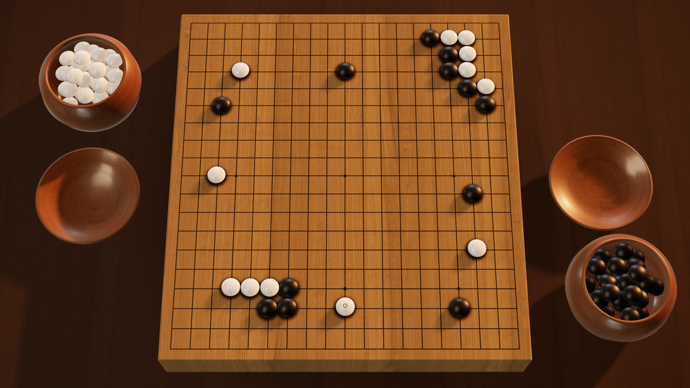
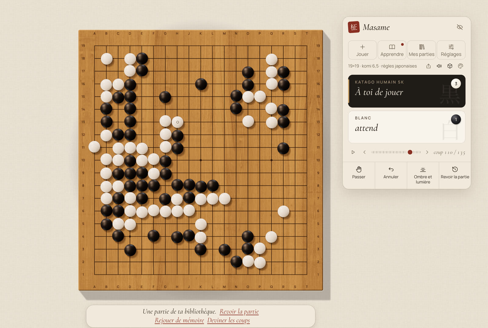
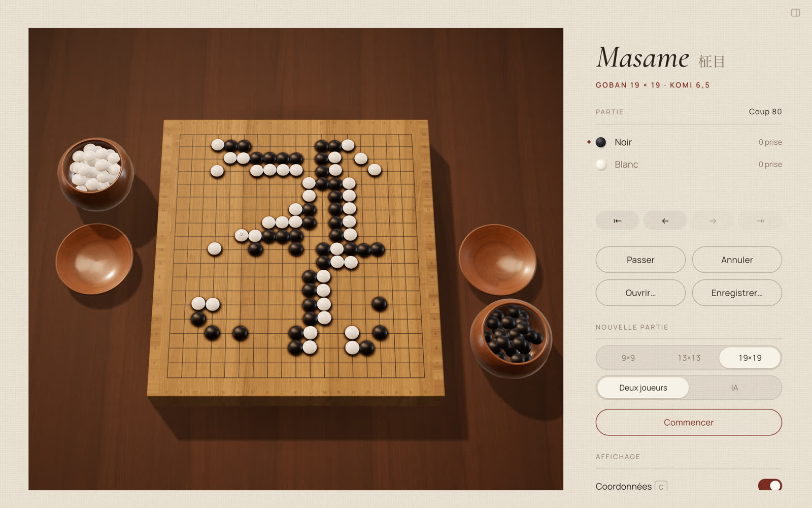
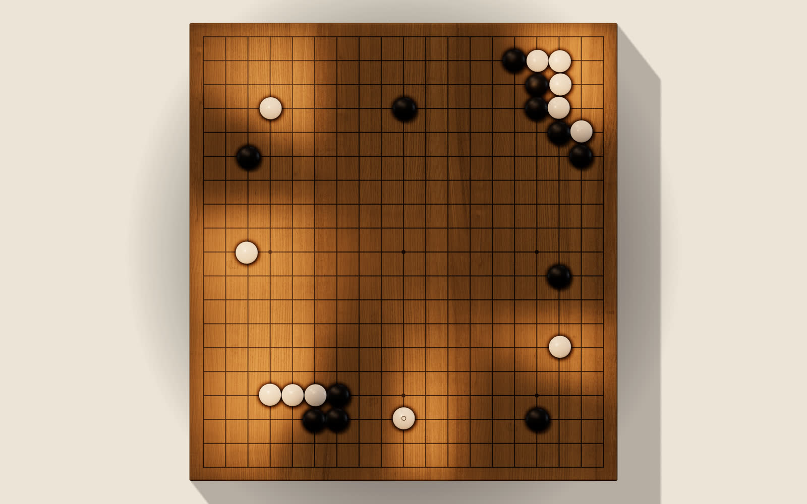
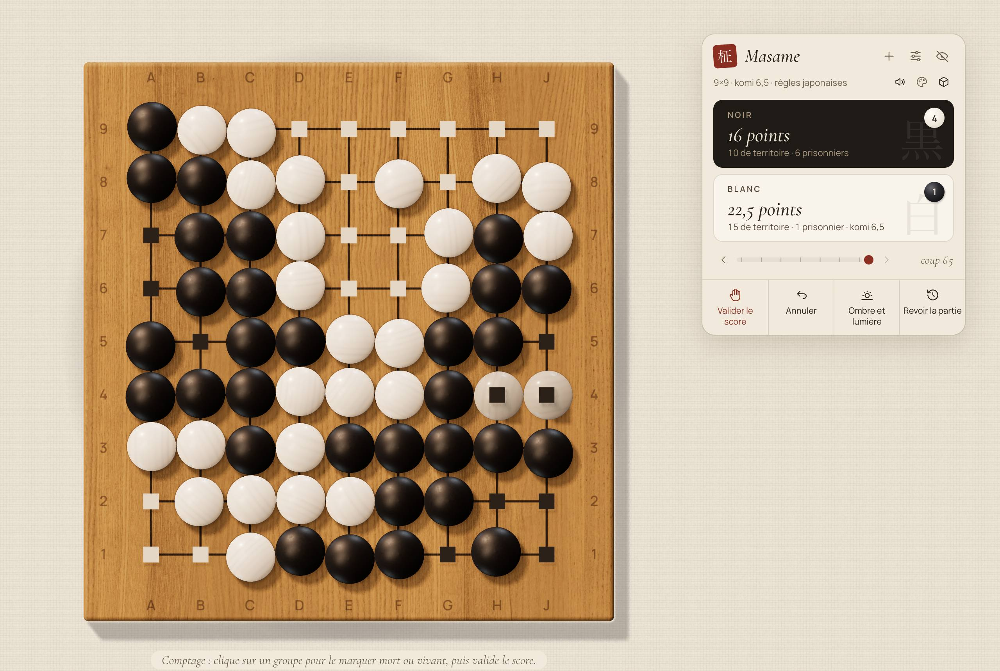
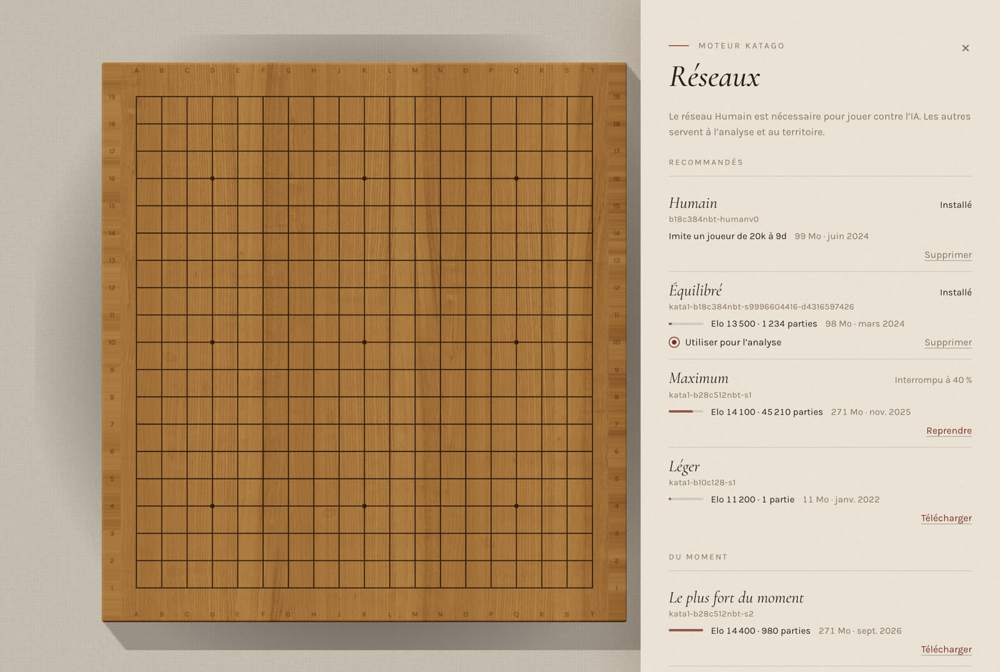
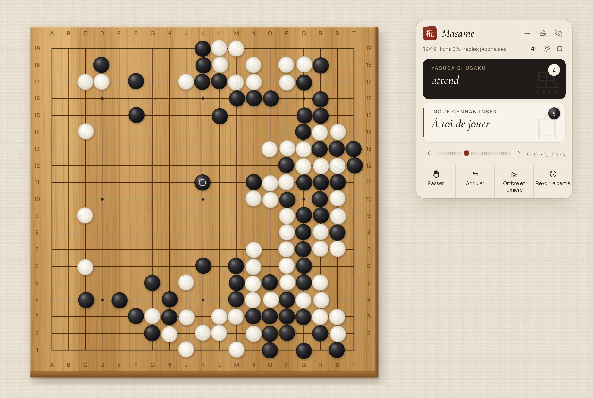
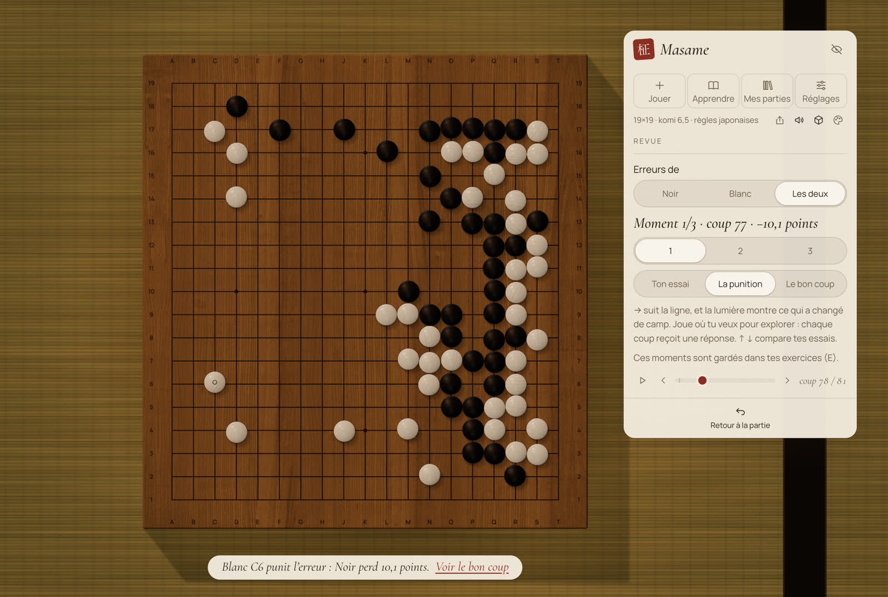
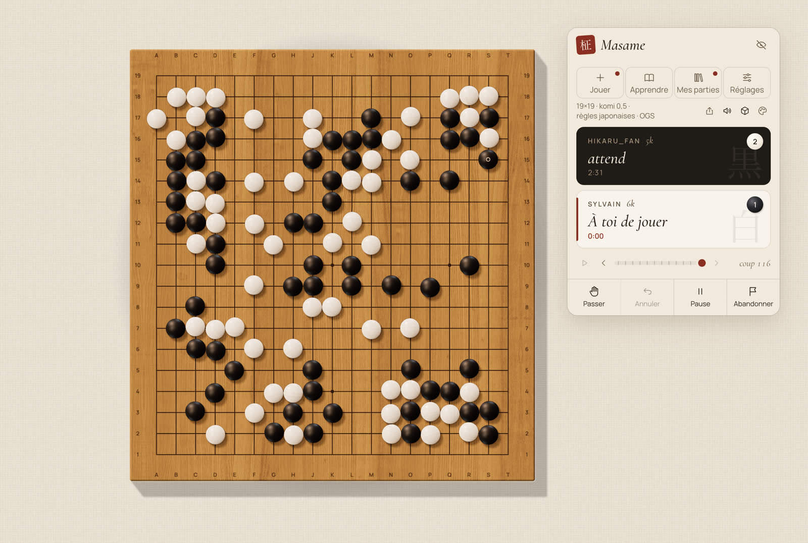

<p align="center">
  
</p>

<h1 align="center">Masame <sub>柾目</sub></h1>

<p align="center">
  <i>Un goban d'artisan — et un professeur qui joue comme un humain.</i>
</p>

<p align="center">
  <a href="LICENSE"></a>
  
  
</p>

<p align="center"><sub><a href="README.md">English</a> · Français</sub></p>

<br>

*Masame*, c'est le grain droit et parallèle qui distingue les plus beaux gobans en kaya. Cette application est faite dans le même esprit : un goban aux vraies proportions et aux vraies matières, bois, ardoise et coquillage, rendus dans une lumière qui suit l'heure du jour. En face de toi, KataGo ne joue pas comme une machine, mais comme un humain du niveau que tu choisis, de 20 kyu à 9 dan. Elle parle français et anglais, fonctionne hors ligne, garde tes parties pour toi, et elle est gratuite.

<br>

<table>
  <tr>
    <td width="50%"><br><sub><b>Étude.</b> Le goban vu d'en haut, la partie sur une carte flottante.</sub></td>
    <td width="50%"><br><sub><b>Contemplation.</b> Le goban posé sur la table, vu de ta place, le soir.</sub></td>
  </tr>
  <tr>
    <td width="50%"><br><sub><b>Ombre et lumière.</b> Le territoire en lumière et en ombre sur le bois.</sub></td>
    <td width="50%"><br><sub><b>Comptage.</b> Pierres mortes proposées par le moteur, corrigées d'un clic.</sub></td>
  </tr>
  <tr>
    <td width="50%"><br><sub><b>Réseaux.</b> Les réseaux officiels de KataGo, téléchargés et vérifiés dans l'app.</sub></td>
    <td width="50%"><br><sub><b>Mode léger.</b> Un goban 2D tout simple, et le repli quand la 3D n'est pas disponible.</sub></td>
  </tr>
  <tr>
    <td width="50%"><br><sub><b>Revue.</b> Chaque coup coûteux devient une courte leçon, ici à l'étape de la punition.</sub></td>
    <td width="50%"><br><sub><b>En ligne.</b> Une partie en direct sur OGS, avec les pendules en byo-yomi sur les deux cartes.</sub></td>
  </tr>
</table>

## Fonctions

- **L'Atelier vivant.** Un goban three.js en temps réel, bois et pierres aux matières physiques, lumière qui suit l'heure du jour, deux vues (Étude, et une vue assise, Contemplation, qu'on tourne et qu'on zoome à la souris), et des bols avec couvercles pour les pierres en réserve et capturées. 9×9, 13×13 et 19×19.
- **Un adversaire humain.** KataGo, avec son réseau humain (SL), imite un joueur de 20k à 9d, avec ajustement automatique du niveau et temps de réflexion naturels (optionnels).
- **Ombre et lumière.** L'estimation de propriété de KataGo affichée en vraie lumière et ombre sur le goban.
- **Comptage.** Le moteur propose les pierres mortes ; tu les corriges d'un clic.
- **Revue de partie.** Jusqu'à trois moments où un coup a coûté le plus de points, chacun une courte leçon : trouve toi-même la punition, vois-la, puis vois le bon coup. Après une partie contre l'IA, ou à tout moment dans une partie à deux joueurs ou un SGF. Elle tourne en local, en une minute environ. À partir d'un moment clé, tu peux aussi essayer ta propre suite, et KataGo répond.
- **Entraîneur de joseki.** Explore les coups candidats avec les points que chacun perd, la fréquence à laquelle les joueurs de ton niveau le jouent, et son origine (classique, pro, IA, vérifié par KataGo, contesté). Entraîne-toi en répétition espacée, dans des orientations et des couleurs au hasard, contre un adversaire qui sort du livre comme les joueurs de ton niveau. Un programme classe les coins selon la fréquence à laquelle tu les rencontreras × les points qu'ils te coûtent. Les joseki sont générés par nous avec KataGo et son réseau humain (SL).
- **Jouer en ligne sur OGS.** Des parties classées sur [online-go.com](https://online-go.com) contre des joueurs, sur le goban de Masame, avec pendules ; tes parties OGS terminées s'ouvrent pour la revue.
- **Règles et parties.** Captures, ko, suicide, passe, annulation, navigation dans les coups, variantes, lecture automatique, et ouverture et enregistrement SGF qui gardent les variantes et les commentaires.
- **Deux langues.** Entièrement en français et en anglais ; suit la langue du système et se change dans l'app.
- **Un mode léger 2D.** Un goban Canvas, utilisé automatiquement quand le rendu 3D n'est pas disponible.

## État

Masame est jeune, et le dit franchement.

- **macOS, Apple Silicon** marche aujourd'hui. Le moteur est un KataGo 1.18.2 (Metal) autonome, aux dépendances statiques ; il faut macOS 13 ou plus récent, et aucune bibliothèque Homebrew à l'exécution.
- **macOS, Intel** est nouveau : la même application, avec KataGo 1.18.2 compilé pour OpenCL et repli automatique sur le processeur ; macOS 13 ou plus récent. En préversion.
- **Windows** est écrit — le code, l'installeur NSIS et une compilation KataGo OpenCL avec repli automatique sur le processeur — et compilé par GitHub Actions. L'installeur est disponible en préversion, pas encore testé sur du vrai matériel.
- **Linux, x86_64** : une AppImage, un .deb et un .rpm, compilés sur Ubuntu 22.04 par GitHub Actions, avec KataGo 1.18.2 compilé depuis les sources (OpenCL, avec repli automatique sur le processeur). En préversion aussi.

**Télécharge** la dernière version sur la [page des versions](https://github.com/Slymaster/masame/releases/latest) : un DMG pour macOS (Apple Silicon, ou Intel : le DMG `x64`), un installeur pour Windows (x64), et une AppImage, un .deb et un .rpm pour Linux (x86_64). La version macOS est signée et notarisée par Apple : elle s'ouvre sans avertissement. La version Windows n'est pas encore signée : quand SmartScreen apparaît, clique sur **Informations complémentaires**, puis **Exécuter quand même**.

Sous **Linux**, Masame demande glibc 2.35 ou plus récent (Ubuntu 22.04+, Debian 12, Fedora, Linux Mint 21+). Quelques points à savoir :

- L'AppImage peut demander `libfuse2` (ou lance-la avec `--appimage-extract-and-run`).
- Fenêtre vide avec le pilote propriétaire NVIDIA : lance Masame avec `WEBKIT_DISABLE_DMABUF_RENDERER=1`.
- Le bruit des pierres demande les plugins « good » de GStreamer (`gstreamer1.0-plugins-good` sur Debian et Ubuntu).
- Le goban 3D demande WebGL2 ; sans lui, Masame passe au goban 2D.

## Compiler depuis les sources

Il faut Node.js 22, [pnpm](https://pnpm.io/) 9, [Rust](https://www.rust-lang.org/tools/install) (stable) avec les [prérequis de Tauri 2](https://v2.tauri.app/start/prerequisites/), et sur macOS Xcode (pour AppleClang, Swift et Metal) ainsi que `cmake`, `ninja`, `pkg-config`, `curl` et `git`. Protobuf et abseil sont compilés depuis des sources épinglées ; voir l'en-tête de [`scripts/build-katago.sh`](scripts/build-katago.sh).

Sous Linux (x86_64), compile plutôt le moteur avec `scripts/build-katago-linux.sh`, qui demande `g++`, `cmake`, `ninja`, `git` et les paquets de développement de zlib, Eigen 3 et OpenCL (sur Debian et Ubuntu : `ninja-build cmake zlib1g-dev libeigen3-dev ocl-icd-opencl-dev opencl-headers`). Il compile les moteurs OpenCL et CPU dans `src-tauri/resources/katago-linux/`.

Pour les Mac Intel, `scripts/build-katago-macos-x86_64.sh` compile les moteurs OpenCL et CPU (sur un Mac Intel, ou en compilation croisée sur Apple Silicon) dans `src-tauri/binaries/` ; compile ensuite avec `pnpm tauri build --target x86_64-apple-darwin --config src-tauri/tauri.macos-x86_64.conf.json`.

```sh
git clone https://github.com/Slymaster/masame.git
cd masame
pnpm install
scripts/build-katago.sh   # compile KataGo v1.18.2 (Metal) dans src-tauri/binaries/
pnpm tauri dev
```

Tests : `pnpm test` (TypeScript) et `cargo test --manifest-path src-tauri/Cargo.toml` (Rust). Les versions Windows sont produites par le workflow GitHub Actions ([`.github/workflows/build.yml`](.github/workflows/build.yml)) ; les instructions locales suivront une fois vérifiées sur du vrai matériel.

## Réseaux

Masame n'embarque aucun réseau de neurones. À la première utilisation, le gestionnaire de réseaux lit le catalogue de l'API katagotraining.org et télécharge les réseaux choisis depuis `media.katagotraining.org`, le site de distribution officiel de KataGo. Chaque fichier est vérifié avec son sha256 publié (ou, pour le réseau humain SL, un sha256 épinglé dans l'app) avant d'être utilisé, et un téléchargement corrompu est supprimé. Les réseaux sont stockés en local, dans le dossier de données de l'app : `~/Library/Application Support/com.sylvainrey.masame/models/` sur macOS.

Les réseaux sont publiés par le projet KataGo sous la [KataGo Neural Network License](https://katagotraining.org/network_license/).

## OGS

Masame est un client OGS. Choisis OGS comme adversaire dans le panneau Partie et connecte-toi : la connexion se fait dans ton navigateur, et Masame ne voit jamais ton mot de passe. Ensuite :

- **Cherche un adversaire** pour une partie classée en 9×9, 13×13 ou 19×19, en cadence blitz, rapide ou live (appariement automatique, comme sur le site).
- **Reprends** tes parties en cours depuis *Mes parties OGS* ; en quitter une ne l'arrête pas, et ta pendule continue de tourner sur OGS.
- **Importe** une partie terminée d'un clic, puis passe-la en revue comme les autres.

OGS n'autorise aucune aide d'un moteur pendant une partie : tant qu'une partie OGS est en cours, Ombre et lumière, les suggestions de comptage du moteur et la revue sont coupées. Elles reviennent dès la fin de la partie.

## Vie privée

- Aucune télémétrie, aucune mesure d'audience, aucun compte Masame.
- Les requêtes réseau vont à katagotraining.org (le catalogue des réseaux et leur téléchargement) et à GitHub pour les mises à jour (github.com et ses serveurs de fichiers). Si tu te connectes à OGS, Masame échange avec online-go.com.
- Au plus une fois par jour, Masame demande à GitHub si une nouvelle version existe (tu peux le désactiver dans les Réglages). Une mise à jour n'est téléchargée que si tu cliques sur Installer, et elle est vérifiée avec la clé de signature de Masame avant d'être installée.
- Tes parties restent sur ta machine ; les fichiers SGF sont enregistrés là où tu le choisis.

## Feuille de route

Les fondations, l'Atelier vivant en 3D et la première partie du professeur sont en place : une revue locale de tes parties, les trois moments qui les ont décidées, « devine, puis découvre ». Le client OGS est là aussi : parties classées, reprise, import et revue. La version 0.3 ajoute l'entraîneur de joseki, les variantes et la lecture automatique. Vient ensuite Masame sur mobile, Android d'abord. Plus tard : des problèmes tirés de tes propres parties, puis d'autres serveurs en ligne après OGS. Le plan complet et ses raisons sont dans [docs/proposition.md](docs/proposition.md) (en anglais : [docs/proposal.en.md](docs/proposal.en.md)).

## Remerciements

- [KataGo](https://github.com/lightvector/KataGo), de David J Wu (« lightvector ») et ses contributeurs : le moteur et ses réseaux de neurones.
- [@sabaki/go-board](https://github.com/SabakiHQ/go-board) et [@sabaki/sgf](https://github.com/SabakiHQ/sgf), de Yichuan Shen : logique du goban et lecture des SGF.
- [goban](https://github.com/online-go/goban), d'Online-Go.com : la connexion et le protocole du client OGS (`goban-engine`, Apache-2.0).
- [FSRS](https://github.com/open-spaced-repetition), d'Open Spaced Repetition : la répétition espacée de l'entraînement aux joseki (MIT).
- [three.js](https://threejs.org/), [Tauri](https://tauri.app/) et [React](https://react.dev/).
- Textures de bois d'[ambientCG](https://ambientcg.com/), éclairage (HDRI) de [Poly Haven](https://polyhaven.com/), sons de pierres de [Freesound](https://freesound.org/) par billhails2, Hongsungbock et MPooman — tous en CC0.
- Polices : Cormorant Garamond et Manrope, sous SIL Open Font License.

## Licence

Masame est publié sous [licence MIT](LICENSE). Les composants tiers gardent leurs propres licences ; la liste complète est dans [THIRD_PARTY_NOTICES.md](THIRD_PARTY_NOTICES.md).
