<p align="center">
  
</p>

<h1 align="center">Masame <sub>柾目</sub></h1>

<p align="center">
  <i>Un goban d'artisan — et un professeur qui joue comme un humain.</i>
</p>

<p align="center">
  <a href="LICENSE"></a>
  
  
</p>

<p align="center"><sub><a href="README.md">English</a> · Français</sub></p>

<br>

*Masame*, c'est le grain droit et parallèle qui distingue les plus beaux gobans en kaya. Cette application est faite dans le même esprit : un goban aux vraies proportions et aux vraies matières, bois, ardoise et coquillage, rendus dans une lumière qui suit l'heure du jour. En face de toi, KataGo ne joue pas comme une machine, mais comme un humain du niveau que tu choisis, de 20 kyu à 9 dan. Elle parle français et anglais, fonctionne hors ligne, garde tes parties pour toi, et elle est gratuite.

<br>

<table>
  <tr>
    <td width="50%"><br><sub><b>Étude.</b> Le goban vu d'en haut, la partie sur une carte flottante et ses quatre portes.</sub></td>
    <td width="50%"><br><sub><b>Contemplation.</b> Le goban posé sur la table, vu de ta place, le soir.</sub></td>
  </tr>
  <tr>
    <td width="50%">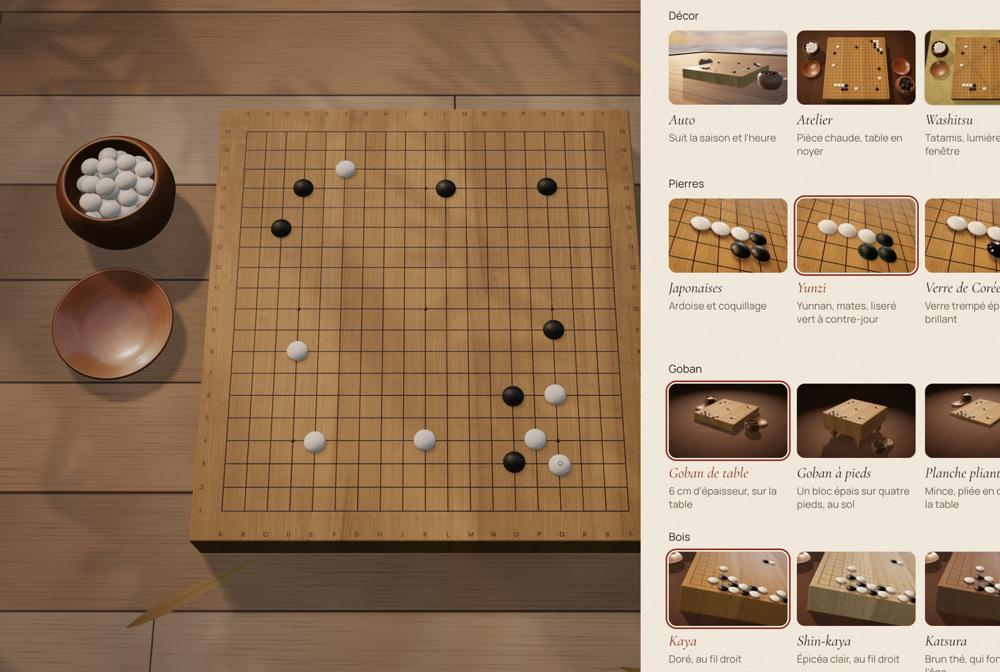<br><sub><b>Atelier.</b> Décors, pierres, gobans et bois, chacun en galerie d'images.</sub></td>
    <td width="50%">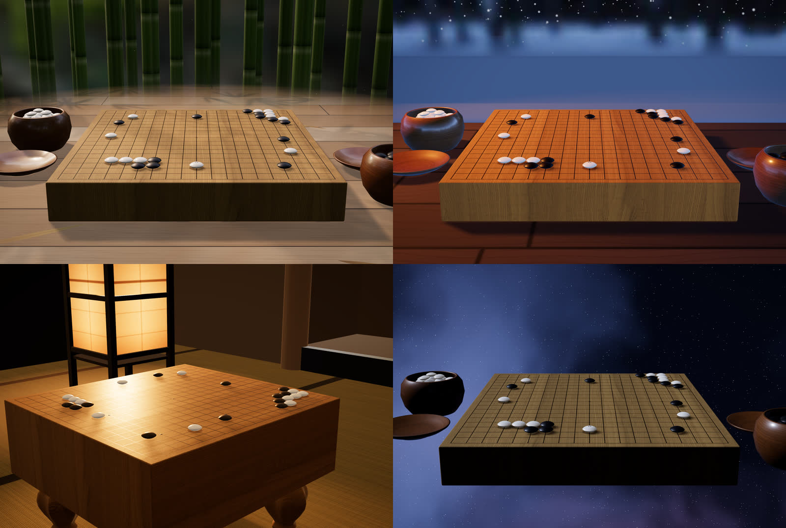<br><sub><b>Des mondes.</b> Lève les yeux : le Jardin de bambous, la Nuit de neige, la Salle Honinbo à la lueur de son andon, le Cosmos.</sub></td>
  </tr>
  <tr>
    <td colspan="2">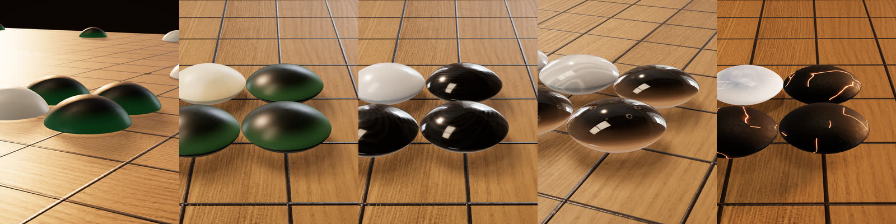<br><sub><b>Pierres.</b> Yunzi à contre-jour, jade, agate, verre soufflé, braise et glace.</sub></td>
  </tr>
  <tr>
    <td width="50%">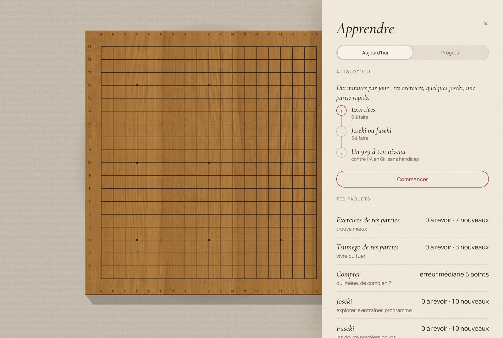<br><sub><b>Apprendre.</b> Le rituel du jour, puis chaque paquet avec ce qui est à revoir.</sub></td>
    <td width="50%">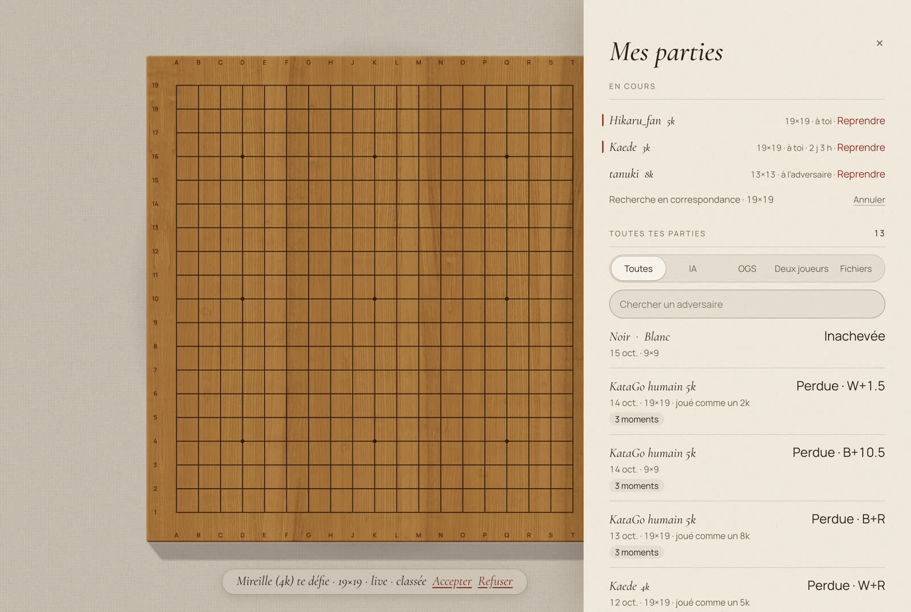<br><sub><b>Mes parties.</b> Chaque partie gardée sur ta machine, les parties OGS en cours d'abord.</sub></td>
  </tr>
  <tr>
    <td width="50%">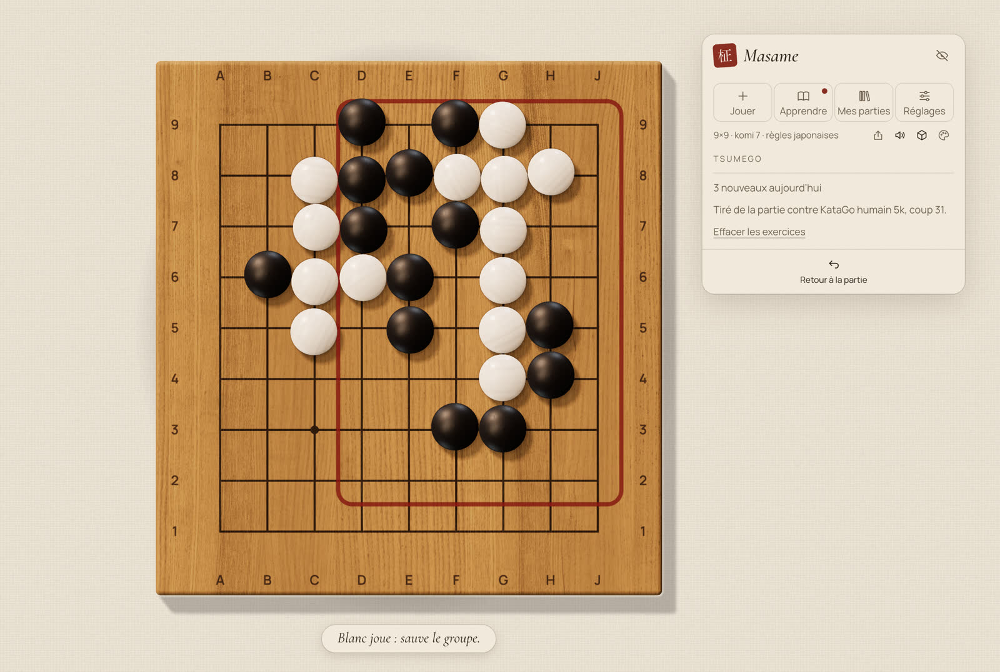<br><sub><b>Tsumego.</b> Un problème de vie et de mort tiré d'une de tes parties, sur tout le goban.</sub></td>
    <td width="50%">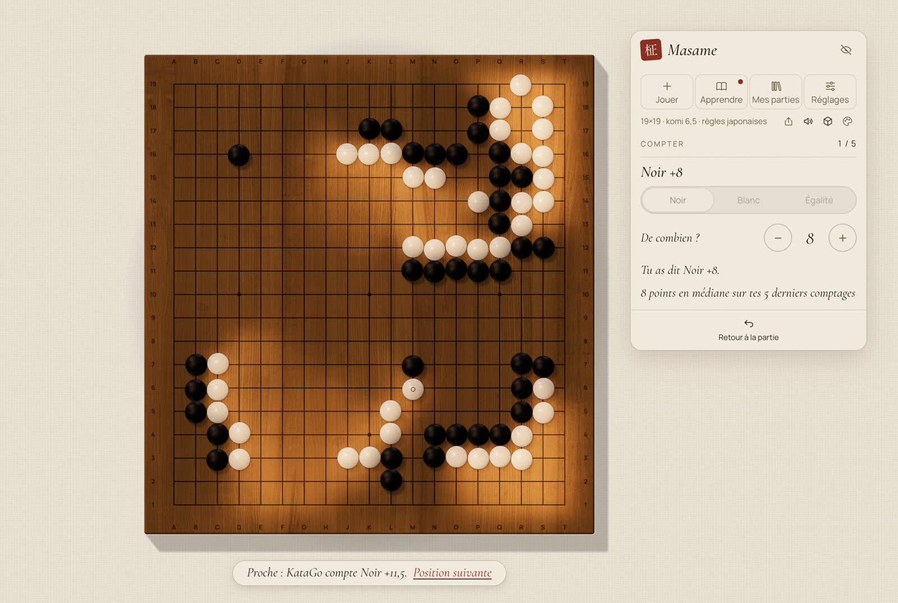<br><sub><b>Compter.</b> Qui mène, et de combien ? Puis le compte de KataGo, et la lumière sur le goban.</sub></td>
  </tr>
  <tr>
    <td width="50%">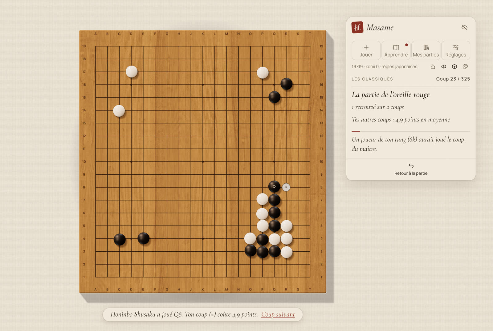<br><sub><b>Les Classiques.</b> La partie de l'oreille rouge, 1846 : joue chaque coup avant de voir celui de Shusaku.</sub></td>
    <td width="50%">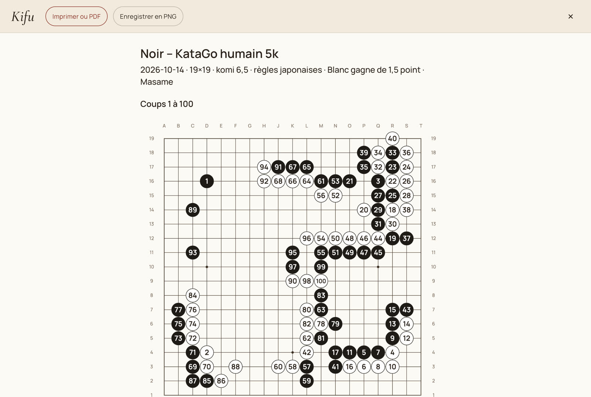<br><sub><b>Kifu.</b> La partie comme l'imprime un livre, pour l'imprimante ou un PDF.</sub></td>
  </tr>
  <tr>
    <td width="50%"><br><sub><b>Revue.</b> Chaque coup coûteux devient une courte leçon, ici à l'étape de la punition.</sub></td>
    <td width="50%"><br><sub><b>En ligne.</b> Une partie en direct sur OGS, avec les pendules en byo-yomi sur les deux cartes.</sub></td>
  </tr>
  <tr>
    <td width="50%">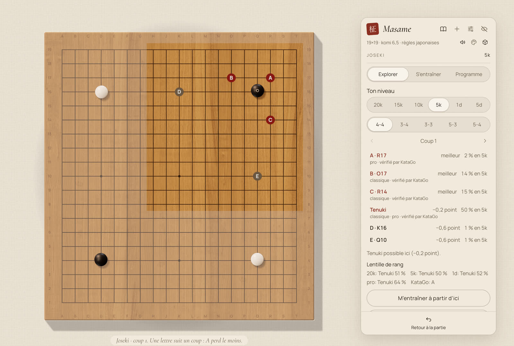<br><sub><b>Joseki.</b> Les coups candidats marqués d'une lettre sur le goban, avec les points que chacun perd et la fréquence à laquelle les joueurs de ton niveau le choisissent.</sub></td>
    <td width="50%">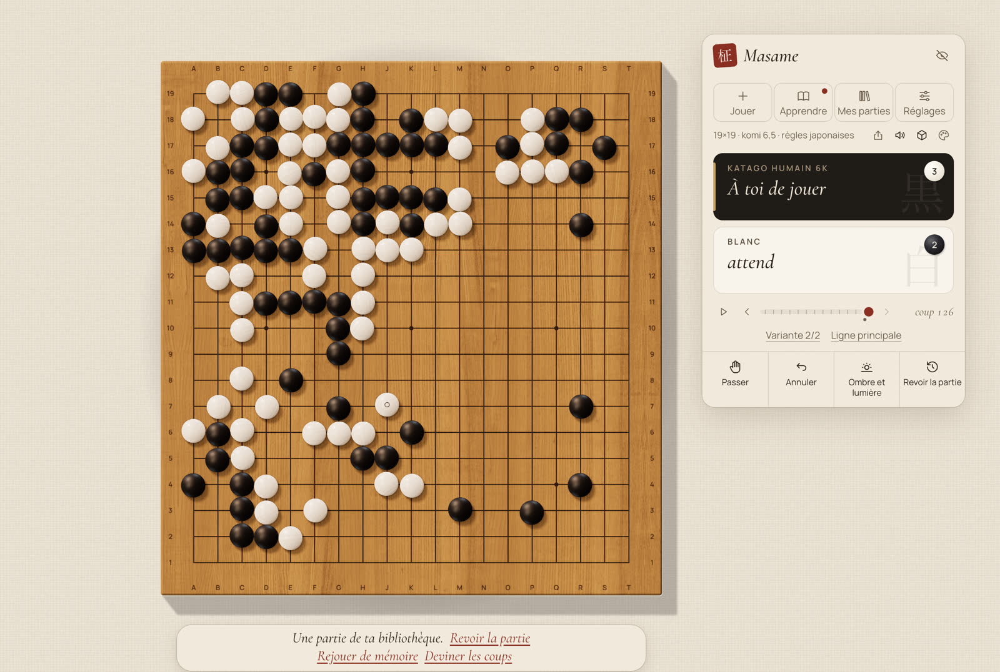<br><sub><b>Variantes.</b> Joue depuis un coup antérieur et la partie garde les deux suites ; ↑ ↓ passent de l'une à l'autre.</sub></td>
  </tr>
  <tr>
    <td width="50%"><br><sub><b>Ombre et lumière.</b> Le territoire en lumière et en ombre sur le bois.</sub></td>
    <td width="50%"><br><sub><b>Fin de partie.</b> Pierres mortes proposées par le moteur, corrigées d'un clic.</sub></td>
  </tr>
  <tr>
    <td width="50%">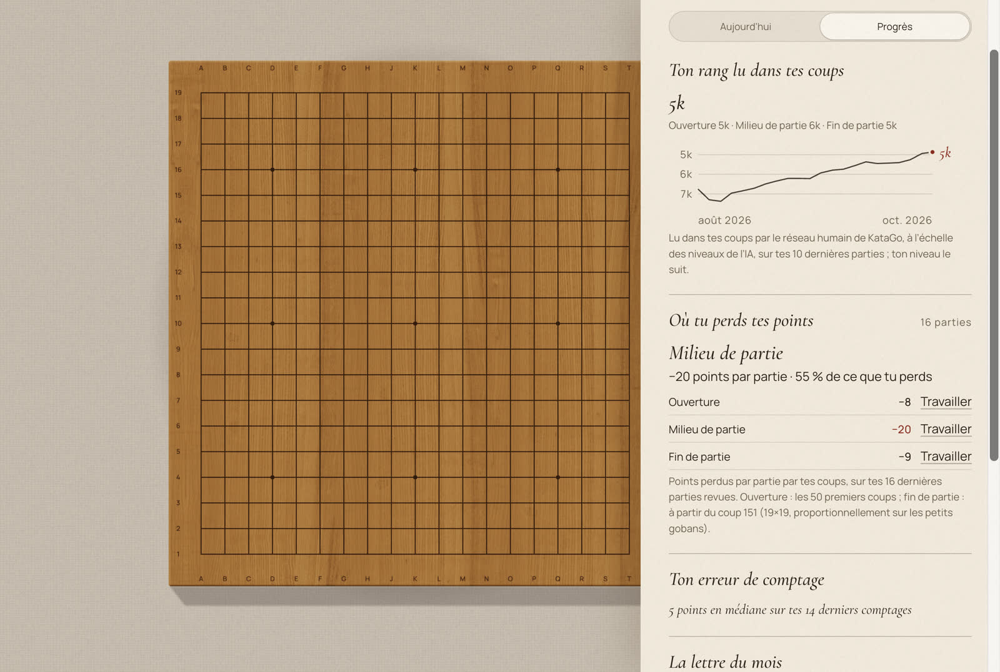<br><sub><b>Progrès.</b> Ton rang lu dans tes coups, où tu perds tes points, et ton erreur de comptage.</sub></td>
    <td width="50%"><br><sub><b>Mode léger.</b> Un goban 2D tout simple, et le repli quand la 3D n'est pas disponible.</sub></td>
  </tr>
  <tr>
    <td width="50%"><br><sub><b>Réseaux.</b> Les réseaux officiels de KataGo, téléchargés et vérifiés dans l'app.</sub></td>
    <td width="50%"></td>
  </tr>
</table>

## Fonctions

Le goban occupe la fenêtre ; à côté, une seule carte flottante porte la partie. Son en-tête a quatre portes : **Jouer**, **Apprendre**, **Mes parties** et **Réglages**. Chacune s'ouvre sur ce qui est en cours, puis montre le reste. Chaque action a une seule place, et le clavier et la barre de menus de macOS la suivent.

### Jouer

- **L'Atelier vivant.** Un goban three.js en temps réel, bois et pierres aux matières physiques, lumière qui suit l'heure du jour, deux vues (Étude, et une vue assise, Contemplation, qu'on tourne et qu'on zoome à la souris), et des bols avec couvercles pour les pierres en réserve et capturées. 9×9, 13×13 et 19×19.
- **Des pierres et des mondes.** Treize jeux de pierres, de l'ardoise et du coquillage japonais aux yunzi du Yunnan, au verre de Corée, au jade, à l'agate, aux galets de rivière et au verre soufflé, dont quatre à gagner ; treize décors, de l'Atelier au Jardin de bambous, à la Nuit de neige, au Hanok, à la Salle Honinbo, à une terrasse Au-dessus des nuages et au Cosmos, où tu peux lever les yeux vers le monde au-delà du goban ; trois formes de goban (de table, à pieds, pliant) en six bois. Le tout dans Réglages › Atelier, en galeries d'images, avec des ambiances toutes prêtes.
- **Un adversaire humain.** KataGo, avec son réseau humain (SL), imite un joueur de 20k à 9d, avec ajustement automatique du niveau et temps de réflexion naturels (optionnels). Des parties à handicap de 2 à 9 pierres, proposé d'après l'écart entre ton niveau et celui de l'IA.
- **Maîtres d'une époque.** Joue contre les professionnels de 1850, 1900, 1935, 1970, 2005 ou 2023, tels que les joue le réseau humain de KataGo, avec le handicap des parties d'enseignement d'autrefois, jusqu'à neuf pierres.
- **Le Mentor.** Allume-le, et Masame t'arrête quand un coup coûte trop (4 points en 19×19, 3 en 13×13, 2 en 9×9) : réessaie, ou garde-le. Une partie avec le mentor est une leçon : elle ne compte jamais pour ton rang.
- **La partie en cours survit à la fermeture.** Ferme Masame en pleine partie : il rouvre sur la même position, la pendule en pause, sans rien demander.
- **Depuis une position.** Recopie une position pierre par pierre, depuis un livre ou une partie, puis joue-la contre l'IA ou à deux, ou enregistre-la.
- **Ombre et lumière.** L'estimation de propriété de KataGo affichée en vraie lumière et ombre sur le goban.
- **Comptage.** Le moteur propose les pierres mortes ; tu les corriges d'un clic.
- **Analyse libre.** Maintiens A sur n'importe quelle position, hors partie OGS en cours : les coups candidats de KataGo apparaissent lettrés sur le goban, avec les points que chacun perd. Pas de courbe de taux de victoire.
- **Jouer en ligne sur OGS.** Des parties classées et des défis sur [online-go.com](https://online-go.com), avec pendules, correspondance comprise ; regarde les meilleures parties en direct. Tes parties OGS en cours et terminées sont dans Mes parties, et tes parties terminées sont revues automatiquement.
- **Règles et parties.** Captures, ko, suicide, passe, annulation, navigation dans les coups, variantes, lecture automatique, une pendule byo-yomi pour les parties locales, et ouverture et enregistrement SGF qui gardent les variantes et les commentaires.

### Apprendre

- **Aujourd'hui.** Un rituel quotidien d'une dizaine de minutes : une main de six exercices (tirés de tes parties, tsumego et comptage, penchée vers ta phase la plus faible), cinq cartes de joseki ou de fuseki, puis un 9×9 contre l'IA à ton niveau, avec une série de jours. Dessous, chaque paquet avec ce qui est à revoir.
- **Exercices tirés de tes parties.** Les moments clés de chaque revue reviennent en exercices, en répétition espacée : trouve un meilleur coup, KataGo le note.
- **Tsumego de tes parties.** Masame trouve des problèmes de vie et de mort dans tes parties revues et les montre sur tout le goban, la zone du problème encadrée : sauve le groupe ou tue-le ; quand tu le manques, KataGo joue la réfutation.
- **Compter.** Qui mène, et de combien ? Une position tirée d'une de tes parties revues, ta réponse, puis le compte de KataGo et la lumière sur le goban.
- **Entraîneur de joseki.** Explore les coups candidats avec les points que chacun perd, la fréquence à laquelle les joueurs de ton niveau le jouent, et son origine (classique, pro, IA, vérifié par KataGo, contesté). Entraîne-toi en répétition espacée, dans des orientations et des couleurs au hasard, contre un adversaire qui sort du livre comme les joueurs de ton niveau. Un programme classe les coins selon la fréquence à laquelle tu les rencontreras × les points qu'ils te coûtent. Les joseki sont générés par nous avec KataGo et son réseau humain (SL).
- **Fuseki.** Les ouvertures sur tout le goban, jusqu'au douzième coup pour les plus jouées, générées comme les joseki, pour explorer et s'entraîner.
- **Les Classiques.** Vingt et une parties de l'époque d'Edo à deviner coup par coup : tu joues chaque coup avant de voir celui du maître, et KataGo dit ce que le tien coûte. Leurs sources sont nommées dans [SOURCES.md](public/assets/classics/SOURCES.md).
- **Progrès.** Ton rang lu dans tes coups, ton classement OGS, où tu perds tes points et ton erreur de comptage, sur une seule page.
- **Ton rang, lu dans tes coups.** Le réseau humain de KataGo dit à quel rang ressemblent tes coups, partie par partie et phase par phase (« tu as joué comme un 7k : ouverture 4k, fin de partie 12k »), à l'échelle des niveaux de l'IA. Cette échelle lit les kyu plus forts qu'OGS : environ deux rangs pour les simples kyu, environ cinq pour les doubles kyu. Avec l'ajustement automatique, il règle ton niveau et garde l'IA à deux rangs au plus de lui ; ton rang local est tracé au fil du temps.
- **Travailler la phase.** À côté de là où tu perds tes points, un bouton par phase : le fuseki pour l'ouverture, exercices et tsumego pour le milieu de partie, et pour la fin de partie une séance de yose qui demande le plus gros coup.
- **La lettre du mois.** Chaque mois, une courte lettre sur ce que tu as joué et appris, une phrase par fait, que tu peux enregistrer en image.

### Mes parties

- **La bibliothèque.** Chaque partie jouée contre l'IA ou à deux, tes parties OGS, les positions que tu enregistres et les fichiers que tu revois sont gardés sur ta machine, avec leur résultat, le rang lu dans tes coups, leurs moments clés et tes scores. Filtre par source, cherche par adversaire, ouvre une partie d'un clic. Tes parties OGS en cours viennent d'abord, celles où c'est à toi de jouer en tête.
- **Revue de partie.** Jusqu'à trois moments où un coup a coûté le plus de points, chacun une courte leçon : trouve toi-même la punition, vois-la, puis vois le bon coup. Après une partie contre l'IA, ou à tout moment dans une partie à deux joueurs ou un SGF. Elle tourne en local, en une minute environ. À partir d'un moment clé, tu peux aussi essayer ta propre suite, et KataGo répond. Chaque partie terminée est aussi lue en arrière-plan, sur ta machine, dès que le moteur est libre, et ses moments clés rejoignent tes exercices sans un clic.
- **Rejouer de mémoire.** Le goban se vide et tu rejoues la partie, les deux camps, coup par coup ; au deuxième échec, le coup s'affiche. Ton score rejoint la partie dans Mes parties.
- **Deviner les coups.** Le mode des Classiques, sur n'importe quelle partie de ta bibliothèque.
- **Partager.** Une petite feuille : enregistre la partie en SGF, fais une carte postale, imprime un kifu, ou copie le lien OGS.
- **Kifu.** La partie comme l'impriment les livres, un diagramme numéroté par centaine de coups, à imprimer ou à enregistrer en PDF par la boîte d'impression du système, ou en PNG.
- **Carte postale.** La position en PNG, un tirage du goban 3D signé du sceau de Masame, prêt pour Reddit ou Discord.
- **Importer.** Ouvre un SGF depuis Mes parties, dépose-le sur la fenêtre, ou double-clique dessus.

### Réglages

- **Les saisons dans la lumière.** En Auto, la lumière suit l'heure et la date : une heure dorée plus longue en été, une lumière basse et froide en hiver, et le reflet de la neige dans le Washitsu de décembre à février.
- **Décor auto, ambiance sonore, profondeur de champ.** Le décor peut suivre la saison et l'heure ; une ambiance sonore discrète (feuilles, vent, pluie) et une profondeur de champ d'objectif quand tu lèves les yeux sont là si tu les veux.
- **La main de l'adversaire.** En vue Contemplation, contre l'IA, la main de ton adversaire prend une pierre dans son bol et la pose. Activée par défaut, elle se désactive dans l'Atelier. Les crédits du modèle : [src-tauri/assets/hand/CREDITS.md](src-tauri/assets/hand/CREDITS.md).
- **Deux langues.** Entièrement en français et en anglais ; suit la langue du système et se change dans l'app.
- **Un mode léger 2D.** Un goban Canvas, utilisé automatiquement quand le rendu 3D n'est pas disponible.

## État

Masame est jeune, et le dit franchement.

- **macOS, Apple Silicon** marche aujourd'hui. Le moteur est un KataGo 1.18.2 (Metal) autonome, aux dépendances statiques ; il faut macOS 13 ou plus récent, et aucune bibliothèque Homebrew à l'exécution.
- **macOS, Intel** : la même application, avec KataGo 1.18.2 compilé pour OpenCL et repli automatique sur le processeur ; macOS 13 ou plus récent. En préversion.
- **Windows** est écrit — le code, l'installeur NSIS et une compilation KataGo OpenCL avec repli automatique sur le processeur — et compilé par GitHub Actions. L'installeur est disponible en préversion, pas encore testé sur du vrai matériel.
- **Linux, x86_64** : une AppImage, un .deb et un .rpm, compilés sur Ubuntu 22.04 par GitHub Actions, avec KataGo 1.18.2 compilé depuis les sources (OpenCL, avec repli automatique sur le processeur). En préversion aussi.

**Télécharge** la dernière version sur la [page des versions](https://github.com/Slymaster/masame/releases/latest) : un DMG pour macOS (Apple Silicon, ou Intel : le DMG `x64`), un installeur pour Windows (x64), et une AppImage, un .deb et un .rpm pour Linux (x86_64). La version macOS est signée et notarisée par Apple : elle s'ouvre sans avertissement. La version Windows n'est pas encore signée : quand SmartScreen apparaît, clique sur **Informations complémentaires**, puis **Exécuter quand même**.

Sous **Linux**, Masame demande glibc 2.35 ou plus récent (Ubuntu 22.04+, Debian 12, Fedora, Linux Mint 21+). Quelques points à savoir :

- L'AppImage peut demander `libfuse2` (ou lance-la avec `--appimage-extract-and-run`).
- Fenêtre vide avec le pilote propriétaire NVIDIA : lance Masame avec `WEBKIT_DISABLE_DMABUF_RENDERER=1`.
- Le bruit des pierres demande les plugins « good » de GStreamer (`gstreamer1.0-plugins-good` sur Debian et Ubuntu).
- Le goban 3D demande WebGL2 ; sans lui, Masame passe au goban 2D.

## Compiler depuis les sources

Il faut Node.js 22, [pnpm](https://pnpm.io/) 9, [Rust](https://www.rust-lang.org/tools/install) (stable) avec les [prérequis de Tauri 2](https://v2.tauri.app/start/prerequisites/), et sur macOS Xcode (pour AppleClang, Swift et Metal) ainsi que `cmake`, `ninja`, `pkg-config`, `curl` et `git`. Protobuf et abseil sont compilés depuis des sources épinglées ; voir l'en-tête de [`scripts/build-katago.sh`](scripts/build-katago.sh).

Sous Linux (x86_64), compile plutôt le moteur avec `scripts/build-katago-linux.sh`, qui demande `g++`, `cmake`, `ninja`, `git` et les paquets de développement de zlib, Eigen 3 et OpenCL (sur Debian et Ubuntu : `ninja-build cmake zlib1g-dev libeigen3-dev ocl-icd-opencl-dev opencl-headers`). Il compile les moteurs OpenCL et CPU dans `src-tauri/resources/katago-linux/`.

Pour les Mac Intel, `scripts/build-katago-macos-x86_64.sh` compile les moteurs OpenCL et CPU (sur un Mac Intel, ou en compilation croisée sur Apple Silicon) dans `src-tauri/binaries/` ; compile ensuite avec `pnpm tauri build --target x86_64-apple-darwin --config src-tauri/tauri.macos-x86_64.conf.json`.

```sh
git clone https://github.com/Slymaster/masame.git
cd masame
pnpm install
scripts/build-katago.sh   # compile KataGo v1.18.2 (Metal) dans src-tauri/binaries/
pnpm tauri dev
```

Tests : `pnpm test` (TypeScript) et `cargo test --manifest-path src-tauri/Cargo.toml` (Rust). Les versions Windows sont produites par le workflow GitHub Actions ([`.github/workflows/build.yml`](.github/workflows/build.yml)) ; les instructions locales suivront une fois vérifiées sur du vrai matériel.

## Réseaux

Masame n'embarque aucun réseau de neurones. À la première utilisation, le gestionnaire de réseaux lit le catalogue de l'API katagotraining.org et télécharge les réseaux choisis depuis `media.katagotraining.org`, le site de distribution officiel de KataGo. Chaque fichier est vérifié avec son sha256 publié (ou, pour le réseau humain SL, un sha256 épinglé dans l'app) avant d'être utilisé, et un téléchargement corrompu est supprimé. Les réseaux sont stockés en local, dans le dossier de données de l'app : `~/Library/Application Support/com.sylvainrey.masame/models/` sur macOS.

Les réseaux sont publiés par le projet KataGo sous la [KataGo Neural Network License](https://katagotraining.org/network_license/).

## OGS

Masame est un client OGS. Choisis OGS comme adversaire dans Jouer et connecte-toi : la connexion se fait dans ton navigateur, et Masame ne voit jamais ton mot de passe. Ensuite :

- **Cherche un adversaire** (appariement automatique) en 9×9, 13×13 ou 19×19, en cadence blitz, rapide, live ou par correspondance. Une recherche par correspondance continue en arrière-plan.
- **Défie un joueur** par son pseudo OGS (classée ou non, handicap automatique ou partie égale) ; accepte ou refuse les défis que tu reçois ; propose une revanche après une partie.
- **Pendant une partie :** annule-la dans les premiers coups, demande à ton adversaire de reprendre un coup (ou accepte sa demande), mets en pause et reprends. Le placement libre du handicap est géré. Quand OGS ne peut pas proposer lui-même les pierres mortes, Masame interroge le compteur d'OGS.
- **Mes parties :** tes parties en cours ouvrent la porte Mes parties, celles où c'est à toi de jouer en tête ; tes parties terminées page par page, gardées dans ta bibliothèque dès que tu en ouvres une. Ton rang OGS au fil du temps est dans Apprendre › Progrès.
- **Regarder :** les meilleures parties en direct, ou n'importe quelle partie depuis un lien OGS, même sans être connecté. L'aide du moteur reste coupée jusqu'à la fin de la partie.
- **Notifications :** quand Masame est ouvert en arrière-plan, une notification système t'avertit quand c'est à toi de jouer dans une partie par correspondance, quand un défi arrive, et quand une partie commence ou se termine.

OGS n'autorise aucune aide d'un moteur pendant une partie : tant qu'une partie OGS est en cours, Ombre et lumière, l'analyse libre, les suggestions de comptage du moteur, la revue, le mentor et les entraîneurs qui utilisent le moteur sont coupés. Ils reviennent dès la fin de la partie, et tes parties OGS terminées sont alors revues automatiquement.

## Vie privée

- Aucune télémétrie, aucune mesure d'audience, aucun compte Masame.
- Les requêtes réseau vont à katagotraining.org (le catalogue des réseaux et leur téléchargement) et à GitHub pour les mises à jour (github.com et ses serveurs de fichiers). Si tu te connectes à OGS, Masame se connecte à online-go.com dès son démarrage, donc tu apparais en ligne là-bas tant qu'il est ouvert. Pour proposer les pierres mortes quand la proposition d'OGS échoue, il peut envoyer la position finale à ai.online-go.com (le compteur d'OGS). Regarder des parties sans compte passe par une connexion OGS anonyme.
- Au plus une fois par jour, Masame demande à GitHub si une nouvelle version existe (tu peux le désactiver dans les Réglages). Une mise à jour n'est téléchargée que si tu cliques sur Installer, et elle est vérifiée avec la clé de signature de Masame avant d'être installée.
- Tes parties restent sur ta machine. La bibliothèque est un dossier dans le dossier de données de l'app (`games/`, à côté de `models/`), et rien de ce qu'il contient n'est envoyé nulle part. Les fichiers SGF que tu exportes sont enregistrés là où tu le choisis.
- La politique de confidentialité complète, pour l'ordinateur et les téléphones : [PRIVACY.md](PRIVACY.md).

## Feuille de route

Les fondations, l'Atelier vivant en 3D et le professeur sont en place, avec le client OGS. La version 0.3 a ajouté l'entraîneur de joseki, les variantes et la lecture automatique ; la version 0.4 a lu tes parties : la revue automatique, les exercices tirés de tes parties, ton rang lu dans tes coups, le rituel du jour, le handicap, l'analyse libre, une pendule locale et la carte postale. La version 0.5 fabrique tes leçons à partir de tes parties : la bibliothèque, les tsumego, le comptage, rejouer de mémoire et les Classiques, avec les Maîtres d'une époque, le mentor, l'éditeur de position et le kifu. La version 0.6 apporte des pierres et des mondes : treize jeux de pierres, treize décors et trois formes de goban en six bois. Vient ensuite Masame sur Android, en bêta, et un installeur Windows signé. Le plan complet et ses raisons sont dans [docs/proposition.md](docs/proposition.md) (en anglais : [docs/proposal.en.md](docs/proposal.en.md)).

## Remerciements

- [KataGo](https://github.com/lightvector/KataGo), de David J Wu (« lightvector ») et ses contributeurs : le moteur et ses réseaux de neurones.
- [@sabaki/go-board](https://github.com/SabakiHQ/go-board) et [@sabaki/sgf](https://github.com/SabakiHQ/sgf), de Yichuan Shen : logique du goban et lecture des SGF.
- [goban](https://github.com/online-go/goban), d'Online-Go.com : la connexion et le protocole du client OGS (`goban-engine`, Apache-2.0).
- [FSRS](https://github.com/open-spaced-repetition), d'Open Spaced Repetition : la répétition espacée de l'entraînement aux joseki (MIT).
- [three.js](https://threejs.org/), [Tauri](https://tauri.app/) et [React](https://react.dev/).
- Textures de bois d'[ambientCG](https://ambientcg.com/), éclairage (HDRI) de [Poly Haven](https://polyhaven.com/) par Greg Zaal, Jarod Guest, Sergej Majboroda, Dario Barresi et Andreas Mischok, sons de pierres et d'ambiance de [Freesound](https://freesound.org/) par billhails2, Hongsungbock, MPooman, ellie.vanderlip, Olichite, Nox_Sound, kyles, PhilllChabbb et callmethefoo — tous en CC0.
- Polices : Cormorant Garamond et Manrope, sous SIL Open Font License.

## Licence

Masame est publié sous [licence MIT](LICENSE). Les composants tiers gardent leurs propres licences ; la liste complète est dans [THIRD_PARTY_NOTICES.md](THIRD_PARTY_NOTICES.md).
