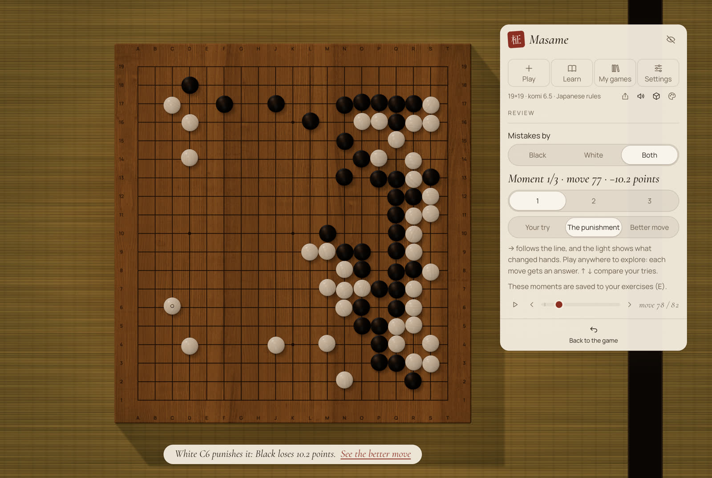
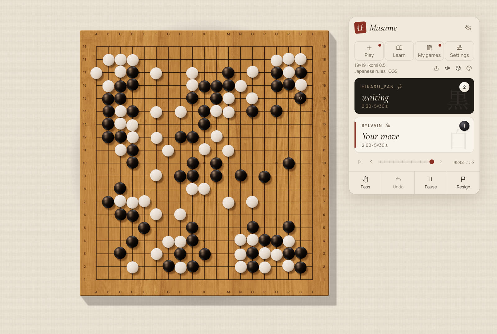

<p align="center">
  
</p>

<h1 align="center">Masame <sub>柾目</sub></h1>

<p align="center">
  <i>A craftsman's Go board — and a teacher that plays like a human.</i>
</p>

<p align="center">
  <a href="LICENSE"></a>
  
  
</p>

<p align="center"><sub>English · <a href="README.fr.md">Français</a></sub></p>

<br>

*Masame* is the straight, parallel grain that marks the finest kaya Go boards. This app is built in the same spirit: a goban with real proportions and real materials, wood and slate and shell rendered in a light that follows the hour of the day. Across it sits KataGo, playing not like a machine but like a human of the rank you choose, from 20 kyu to 9 dan. It speaks French and English, works offline, keeps your games to yourself, and is free.

<br>

<table>
  <tr>
    <td width="50%"><br><sub><b>Study.</b> The board seen from above, the game on a floating card.</sub></td>
    <td width="50%"><br><sub><b>Contemplation.</b> The board as it sits on the table, seen from where you sit, in the evening.</sub></td>
  </tr>
  <tr>
    <td width="50%"><br><sub><b>Light and Shadow.</b> Territory shown as light and shade falling on the wood.</sub></td>
    <td width="50%"><br><sub><b>Counting.</b> Dead stones suggested by the engine, corrected with a click.</sub></td>
  </tr>
  <tr>
    <td width="50%"><br><sub><b>Networks.</b> Official KataGo networks, downloaded and verified in the app.</sub></td>
    <td width="50%"><br><sub><b>Light mode.</b> A quiet 2D board, and the fallback when 3D is unavailable.</sub></td>
  </tr>
  <tr>
    <td width="50%"><br><sub><b>Review.</b> Each costly move becomes a short lesson, here at the punishment.</sub></td>
    <td width="50%"><br><sub><b>Online.</b> A live game on OGS, with byo-yomi clocks on both cards.</sub></td>
  </tr>
</table>

## Features

- **The Living Atelier.** A real-time three.js board with physically based wood and stones, light that follows the time of day, two views (Study, and a seated Contemplation view you can turn and zoom with the mouse), and bowls with lids for the spare and captured stones. 9×9, 13×13 and 19×19.
- **A human opponent.** KataGo with its human SL network imitates a player from 20k to 9d, with optional automatic level adjustment and natural thinking times.
- **Light and Shadow.** KataGo's ownership estimate shown as real light and shade on the board.
- **Counting.** The engine proposes the dead stones; you correct them with a click.
- **Game review.** Up to three moments where a move cost the most points, each a short lesson: find the punishment yourself, see it, then see the better move. After a game against the AI, or at any time in a two-player or SGF game. It runs locally, in about a minute. From a key moment you can also try your own continuation, and KataGo answers.
- **Joseki trainer.** Explore the candidate moves with the points each one loses, how often players of your level play it, and where it comes from (classic, pro, AI, verified by KataGo, contested). Practise with spaced repetition, in random orientations and colours, against an opponent who leaves the book like players of your level. A programme orders the corners by how often you'll meet them × the points they cost you. The joseki are generated by us with KataGo and its human SL network.
- **Online play on OGS.** Ranked games on [online-go.com](https://online-go.com) against people, on Masame's board, with clocks; your finished OGS games open for review.
- **Rules and records.** Captures, ko, suicide, pass, undo, move navigation, variations, autoplay, and SGF open and save that keep variations and comments.
- **Two languages.** Entirely in French and English, following the system language, switchable in the app.
- **A 2D light mode.** A Canvas board, used automatically when the 3D renderer is unavailable.

## Status

Masame is young, and honest about it.

- **macOS, Apple Silicon** works today. The engine is a self-contained KataGo 1.18.2 (Metal) with static dependencies; it needs macOS 13 or later and no Homebrew libraries at run time.
- **macOS, Intel** is new: the same app with KataGo 1.18.2 built for OpenCL, with automatic CPU fallback; macOS 13 or later. A preview.
- **Windows** support is written — the code, the NSIS installer and a KataGo OpenCL build with automatic CPU fallback — and built by GitHub Actions. The installer is available as a preview, not yet tested on real hardware.
- **Linux, x86_64**: an AppImage, a .deb and an .rpm, built on Ubuntu 22.04 by GitHub Actions, with KataGo 1.18.2 compiled from source (OpenCL, with automatic CPU fallback). Also a preview.

**Download** the latest version from the [releases page](https://github.com/Slymaster/masame/releases/latest): a DMG for macOS (Apple Silicon, or Intel: the `x64` DMG), an installer for Windows (x64), and an AppImage, a .deb and an .rpm for Linux (x86_64). The macOS build is signed and notarized by Apple, so it opens without a warning. The Windows build is not signed yet: when SmartScreen appears, click **More info**, then **Run anyway**.

On **Linux**, Masame needs glibc 2.35 or later (Ubuntu 22.04+, Debian 12, Fedora, Linux Mint 21+). A few things to know:

- The AppImage may need `libfuse2` (or run it with `--appimage-extract-and-run`).
- A blank window with NVIDIA's proprietary driver: start Masame with `WEBKIT_DISABLE_DMABUF_RENDERER=1`.
- Stone sounds need GStreamer's "good" plugins (`gstreamer1.0-plugins-good` on Debian and Ubuntu).
- The 3D board needs WebGL2; without it Masame uses the 2D board.

## Build from source

You will need Node.js 22, [pnpm](https://pnpm.io/) 9, [Rust](https://www.rust-lang.org/tools/install) (stable) with the [Tauri 2 prerequisites](https://v2.tauri.app/start/prerequisites/), and on macOS Xcode (for AppleClang, Swift and Metal) plus `cmake`, `ninja`, `pkg-config`, `curl` and `git`. Protobuf and abseil are built from pinned sources; see the header of [`scripts/build-katago.sh`](scripts/build-katago.sh).

On Linux (x86_64), build the engine with `scripts/build-katago-linux.sh` instead, which needs `g++`, `cmake`, `ninja`, `git` and the development packages for zlib, Eigen 3 and OpenCL (on Debian and Ubuntu: `ninja-build cmake zlib1g-dev libeigen3-dev ocl-icd-opencl-dev opencl-headers`). It builds the OpenCL and CPU engines into `src-tauri/resources/katago-linux/`.

For Intel Macs, `scripts/build-katago-macos-x86_64.sh` builds the OpenCL and CPU engines (on an Intel Mac, or cross-compiled on Apple Silicon) into `src-tauri/binaries/`; then build with `pnpm tauri build --target x86_64-apple-darwin --config src-tauri/tauri.macos-x86_64.conf.json`.

```sh
git clone https://github.com/Slymaster/masame.git
cd masame
pnpm install
scripts/build-katago.sh   # builds KataGo v1.18.2 (Metal) into src-tauri/binaries/
pnpm tauri dev
```

Tests: `pnpm test` (TypeScript) and `cargo test --manifest-path src-tauri/Cargo.toml` (Rust). Windows builds come from the GitHub Actions workflow ([`.github/workflows/build.yml`](.github/workflows/build.yml)); local instructions will follow once they are verified on hardware.

## Networks

Masame ships no neural network. On first use, the network manager reads the catalogue from the katagotraining.org API and downloads the networks you choose from `media.katagotraining.org`, the official KataGo distribution site. Each file is checked against its published sha256 (or, for the human SL network, a sha256 pinned in the app) before it is used, and a corrupted download is deleted. Networks are stored locally, in the app's data folder: `~/Library/Application Support/com.sylvainrey.masame/models/` on macOS.

The networks are published by the KataGo project under the [KataGo Neural Network License](https://katagotraining.org/network_license/).

## OGS

Masame is an OGS client. Choose OGS as the opponent in the Game sheet and sign in: sign-in happens in your browser, and Masame never sees your password. Then:

- **Find an opponent** for a ranked game at 9×9, 13×13 or 19×19, in blitz, rapid or live pace (automatch, as on the site).
- **Resume** your ongoing games from *My OGS games*; leaving one doesn't stop it, and your clock keeps running at OGS.
- **Import** a finished game with one click, then review it like any other.

OGS doesn't allow engine help during a game, so while an OGS game is going on, Light and Shadow, the engine's counting suggestions and the review are off. They come back as soon as the game is over.

## Privacy

- No telemetry, no analytics, no Masame account.
- Network requests go to katagotraining.org (the network catalogue and the network downloads) and to GitHub for updates (github.com and its file servers). If you sign in to OGS, Masame talks to online-go.com.
- At most once a day, Masame asks GitHub whether a new version exists (you can turn this off in Settings). An update is downloaded only when you click Install, and is checked against Masame's signing key before it is installed.
- Your games stay on your machine; SGF files are saved where you choose.

## Roadmap

The foundations, the 3D Living Atelier and the teacher's first part are in place: a local review of your games, the three moments that decided them, "guess, then reveal". The OGS client is here too: ranked games, resume, import and review. Version 0.3 adds the joseki trainer, variations and autoplay. Next comes Masame on mobile. The full plan and its reasoning are in [docs/proposal.en.md](docs/proposal.en.md) (in French: [docs/proposition.md](docs/proposition.md)).

## Credits

- [KataGo](https://github.com/lightvector/KataGo) by David J Wu ("lightvector") and contributors: the engine and its neural networks.
- [@sabaki/go-board](https://github.com/SabakiHQ/go-board) and [@sabaki/sgf](https://github.com/SabakiHQ/sgf) by Yichuan Shen: board logic and SGF parsing.
- [goban](https://github.com/online-go/goban) by Online-Go.com: the OGS client's connection and protocol (`goban-engine`, Apache-2.0).
- [FSRS](https://github.com/open-spaced-repetition) by Open Spaced Repetition: the spaced repetition behind joseki practice (MIT).
- [three.js](https://threejs.org/), [Tauri](https://tauri.app/) and [React](https://react.dev/).
- Wood textures from [ambientCG](https://ambientcg.com/), lighting (HDRI) from [Poly Haven](https://polyhaven.com/), stone sounds from [Freesound](https://freesound.org/) by billhails2, Hongsungbock and MPooman — all CC0.
- Typefaces: Cormorant Garamond and Manrope, under the SIL Open Font License.

## Licence

Masame is released under the [MIT licence](LICENSE). Third-party components keep their own licences; the full list is in [THIRD_PARTY_NOTICES.md](THIRD_PARTY_NOTICES.md).
