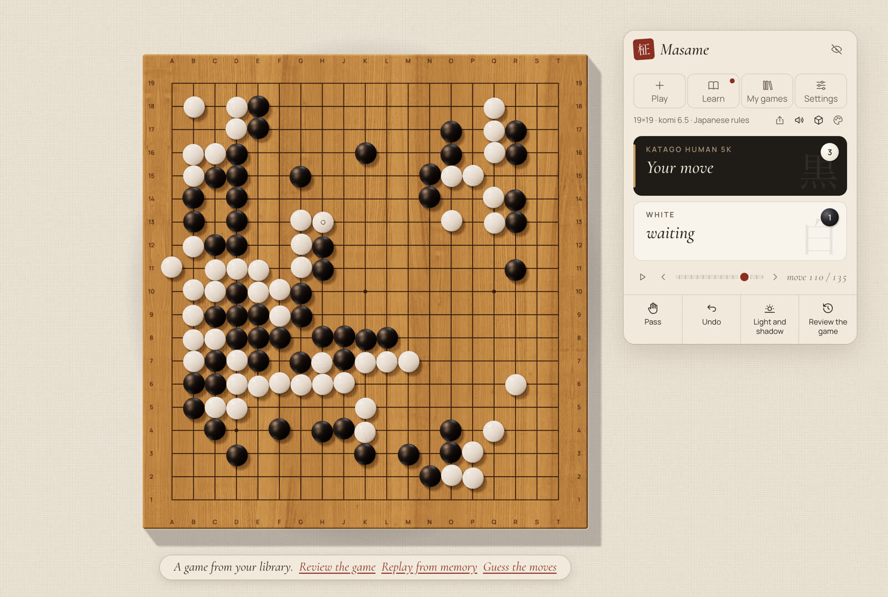
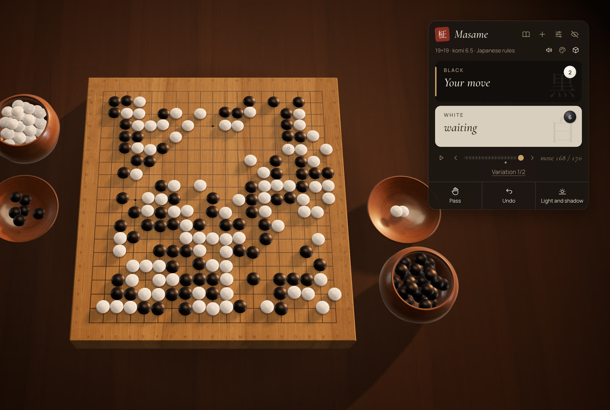
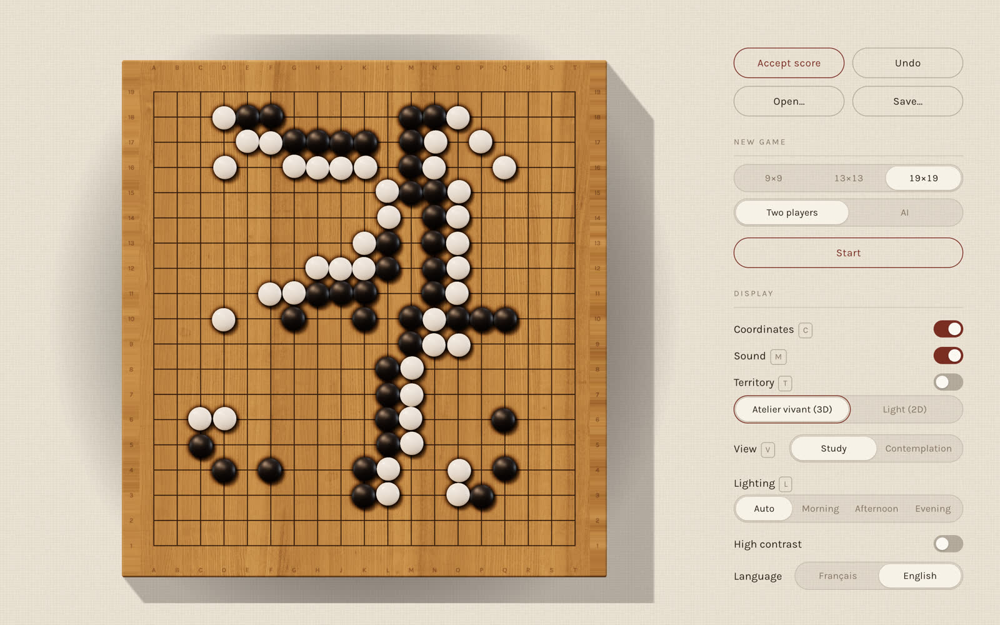
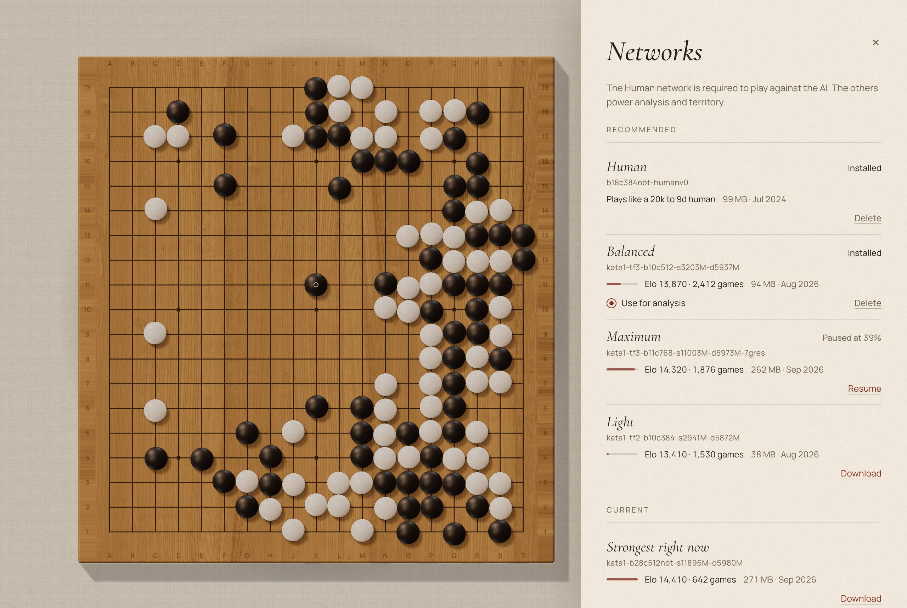
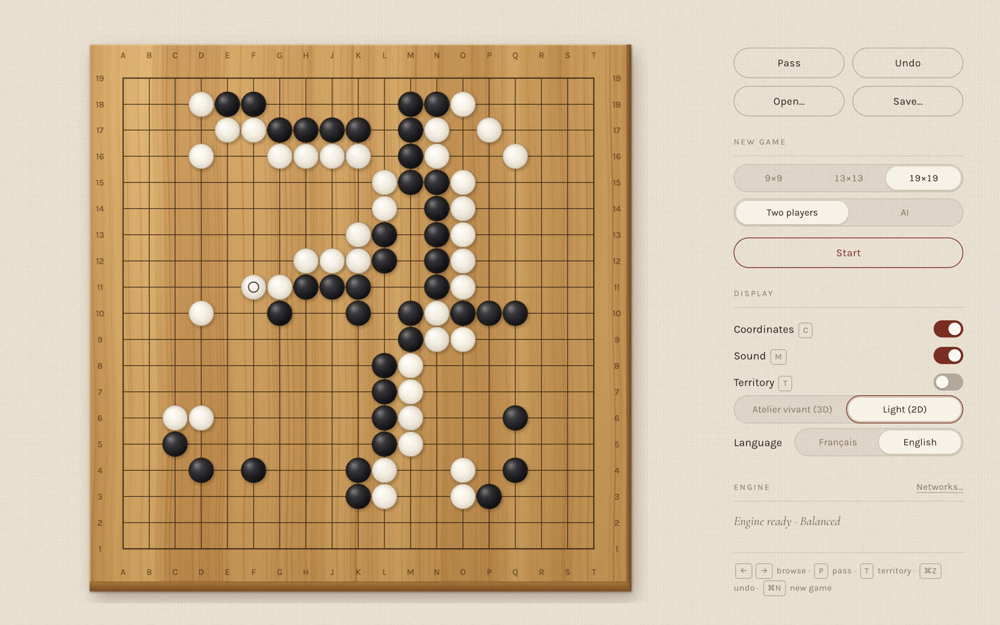

<p align="center">
  
</p>

<h1 align="center">Masame <sub>柾目</sub></h1>

<p align="center">
  <i>A craftsman's Go board — and a teacher that plays like a human.</i>
</p>

<p align="center">
  <a href="LICENSE"></a>
  
  
</p>

<p align="center"><sub>English · <a href="README.fr.md">Français</a></sub></p>

<br>

*Masame* is the straight, parallel grain that marks the finest kaya Go boards. This app is built in the same spirit: a goban with real proportions and real materials, wood and slate and shell rendered in a light that follows the hour of the day. Across it sits KataGo, playing not like a machine but like a human of the rank you choose, from 20 kyu to 9 dan. It speaks French and English, works offline, keeps your games to yourself, and is free.

<br>

<table>
  <tr>
    <td width="50%"><br><sub><b>Study.</b> The board seen from above, with the game beside it.</sub></td>
    <td width="50%"><br><sub><b>Contemplation.</b> The board as it sits on the table, seen from where you sit.</sub></td>
  </tr>
  <tr>
    <td width="50%"><br><sub><b>Light and Shadow.</b> Territory shown as light and shade falling on the wood.</sub></td>
    <td width="50%"><br><sub><b>Counting.</b> Dead stones suggested by the engine, corrected with a click.</sub></td>
  </tr>
  <tr>
    <td width="50%"><br><sub><b>Networks.</b> Official KataGo networks, downloaded and verified in the app.</sub></td>
    <td width="50%"><br><sub><b>Light mode.</b> A quiet 2D board, and the fallback when 3D is unavailable.</sub></td>
  </tr>
</table>

## Features

- **The Living Atelier.** A real-time three.js board with physically based wood and stones, light that follows the time of day, two views (Study and Contemplation), and bowls with lids for the spare and captured stones. 9×9, 13×13 and 19×19.
- **A human opponent.** KataGo with its human SL network imitates a player from 20k to 9d, with optional automatic level adjustment and natural thinking times.
- **Light and Shadow.** KataGo's ownership estimate shown as real light and shade on the board.
- **Counting.** The engine proposes the dead stones; you correct them with a click.
- **Rules and records.** Captures, ko, suicide, pass, undo, move navigation, SGF open and save.
- **Two languages.** Entirely in French and English, following the system language, switchable in the app.
- **A 2D light mode.** A Canvas board, used automatically when the 3D renderer is unavailable.

## Status

Masame is young, and honest about it.

- **macOS, Apple Silicon** works today. The engine is a self-contained KataGo 1.18.2 (Metal) with static dependencies; it needs macOS 13 or later and no Homebrew libraries at run time.
- **Windows** support is written — the code, the NSIS installer and a KataGo OpenCL build with automatic CPU fallback — and built by GitHub Actions. The installer is available as a preview, not yet tested on real hardware.

**Download** the latest version from the [releases page](https://github.com/Slymaster/masame/releases/latest): a DMG for macOS (Apple Silicon) and an installer for Windows (x64). The builds are not signed yet, so the system warns on first launch:

- **macOS:** if Masame is blocked, open System Settings → Privacy & Security and click **Open Anyway**.
- **Windows:** when SmartScreen appears, click **More info**, then **Run anyway**.

## Build from source

You will need Node.js 22, [pnpm](https://pnpm.io/) 9, [Rust](https://www.rust-lang.org/tools/install) (stable) with the [Tauri 2 prerequisites](https://v2.tauri.app/start/prerequisites/), and on macOS Xcode (for AppleClang, Swift and Metal) plus `cmake`, `ninja`, `pkg-config`, `curl` and `git`. Protobuf and abseil are built from pinned sources; see the header of [`scripts/build-katago.sh`](scripts/build-katago.sh).

```sh
git clone https://github.com/Slymaster/masame.git
cd masame
pnpm install
scripts/build-katago.sh   # builds KataGo v1.18.2 (Metal) into src-tauri/binaries/
pnpm tauri dev
```

Tests: `pnpm test` (TypeScript) and `cargo test --manifest-path src-tauri/Cargo.toml` (Rust). Windows builds come from the GitHub Actions workflow ([`.github/workflows/build.yml`](.github/workflows/build.yml)); local instructions will follow once they are verified on hardware.

## Networks

Masame ships no neural network. On first use, the network manager reads the catalogue from the katagotraining.org API and downloads the networks you choose from `media.katagotraining.org`, the official KataGo distribution site. Each file is checked against its published sha256 (or, for the human SL network, a sha256 pinned in the app) before it is used, and a corrupted download is deleted. Networks are stored locally, in the app's data folder: `~/Library/Application Support/com.sylvainrey.masame/models/` on macOS.

The networks are published by the KataGo project under the [KataGo Neural Network License](https://katagotraining.org/network_license/).

## Privacy

- No telemetry, no analytics, no account.
- The only network requests go to katagotraining.org: the network catalogue and the network downloads.
- Your games stay on your machine; SGF files are saved where you choose.

## Roadmap

The foundations and the 3D Living Atelier are in place. Next comes the teacher — an automatic local review of your games, the three moments that decided them, "guess, then reveal" — then an OGS client, then daily training built from your own games. The full plan and its reasoning are in [docs/proposal.en.md](docs/proposal.en.md) (in French: [docs/proposition.md](docs/proposition.md)).

## Credits

- [KataGo](https://github.com/lightvector/KataGo) by David J Wu ("lightvector") and contributors: the engine and its neural networks.
- [@sabaki/go-board](https://github.com/SabakiHQ/go-board) and [@sabaki/sgf](https://github.com/SabakiHQ/sgf) by Yichuan Shen: board logic and SGF parsing.
- [three.js](https://threejs.org/), [Tauri](https://tauri.app/) and [React](https://react.dev/).
- Wood textures from [ambientCG](https://ambientcg.com/), lighting (HDRI) from [Poly Haven](https://polyhaven.com/), stone sounds from [Freesound](https://freesound.org/) by billhails2, Hongsungbock and MPooman — all CC0.
- Typefaces: Cormorant Garamond and Manrope, under the SIL Open Font License.

## Licence

Masame is released under the [MIT licence](LICENSE). Third-party components keep their own licences; the full list is in [THIRD_PARTY_NOTICES.md](THIRD_PARTY_NOTICES.md).
