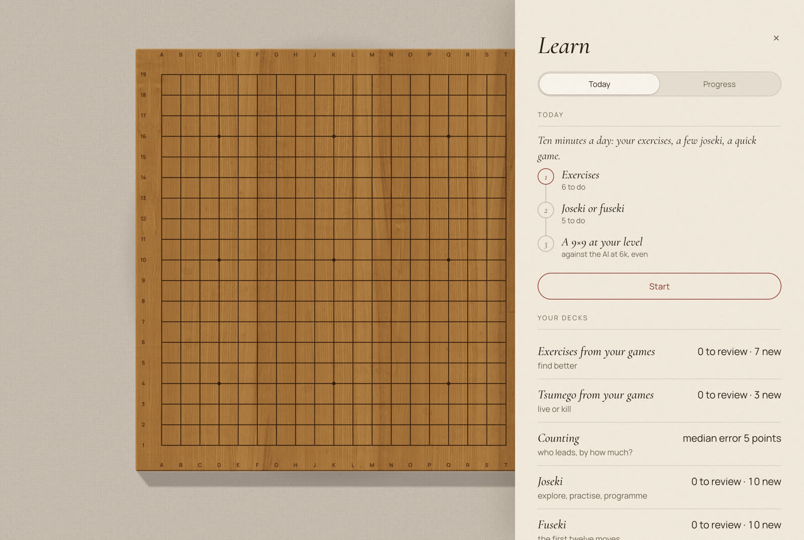
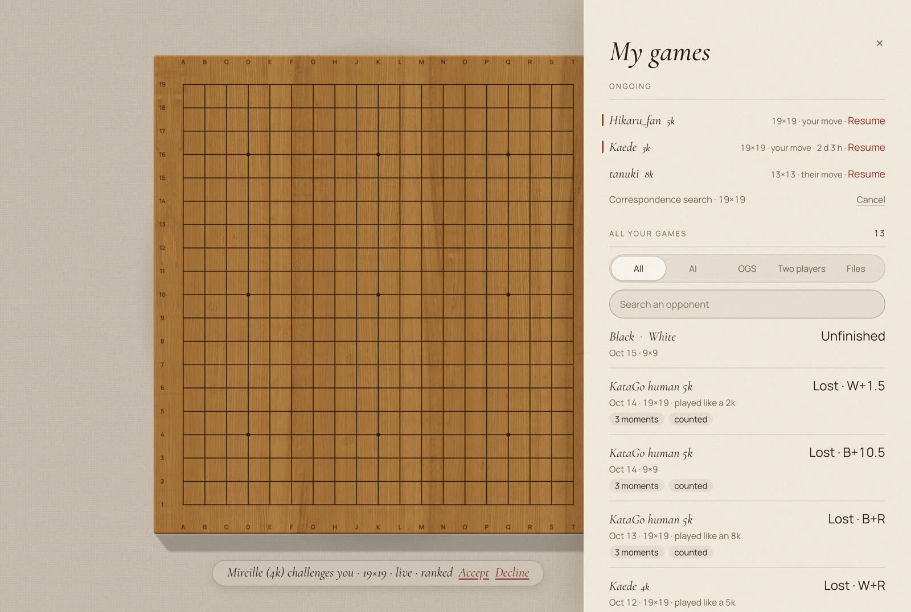
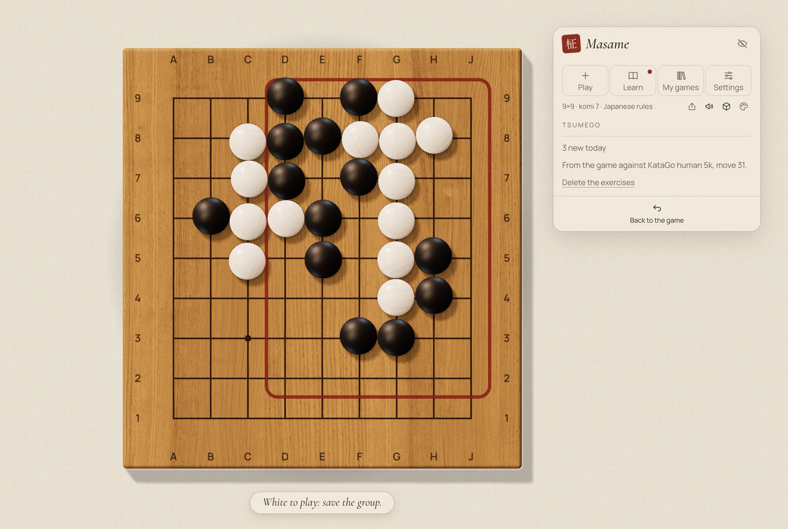
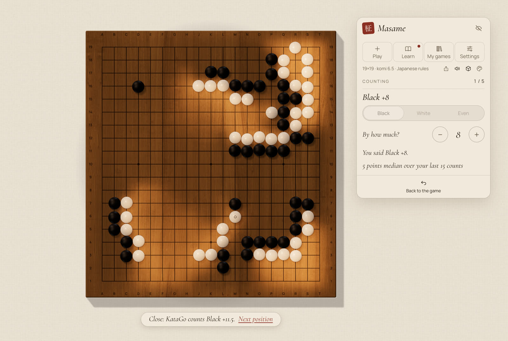
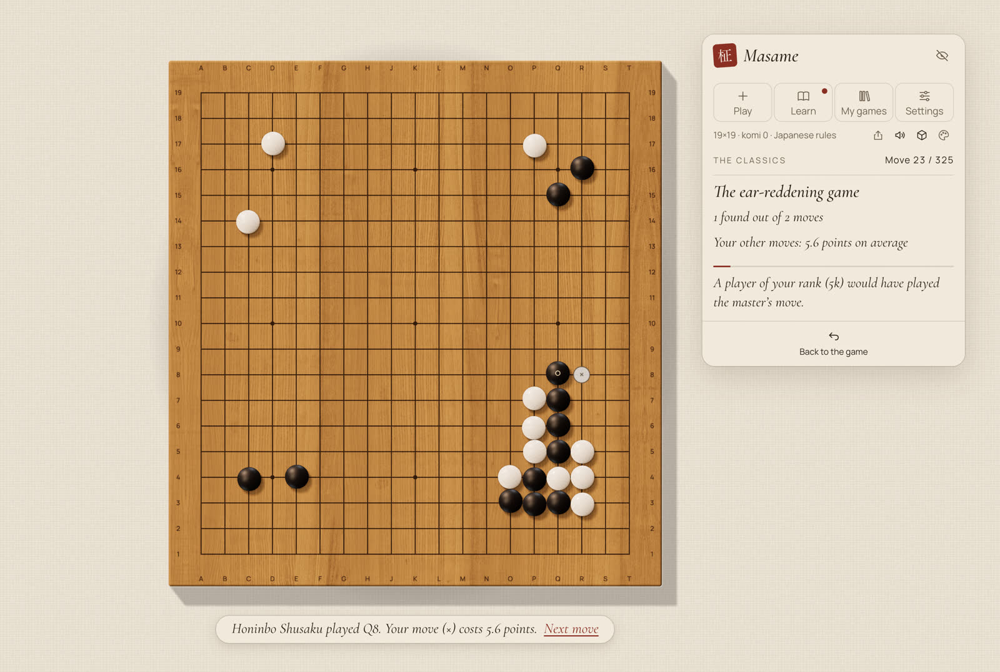
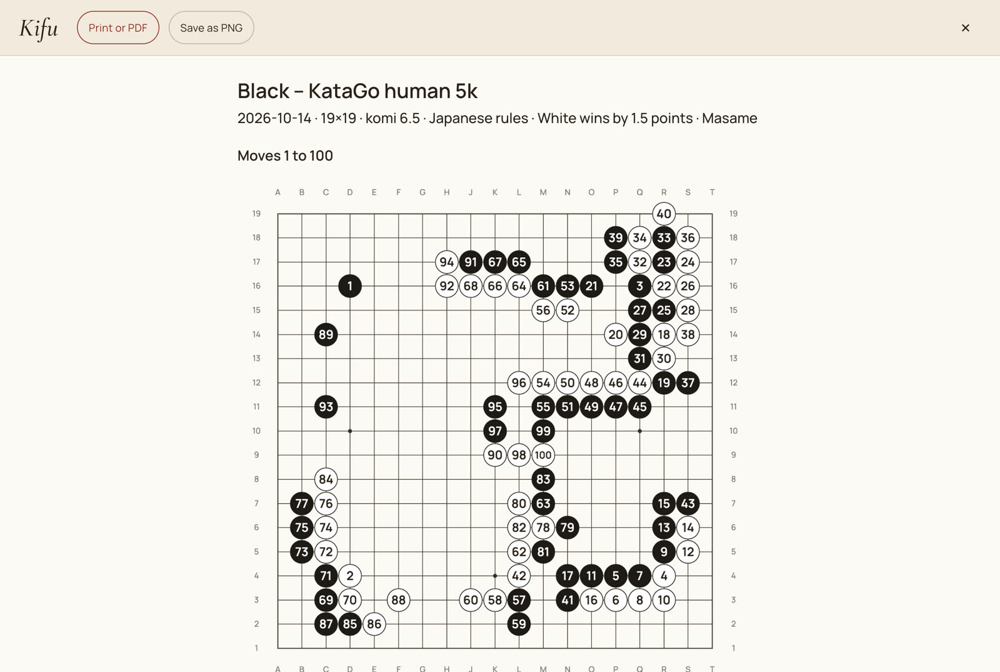
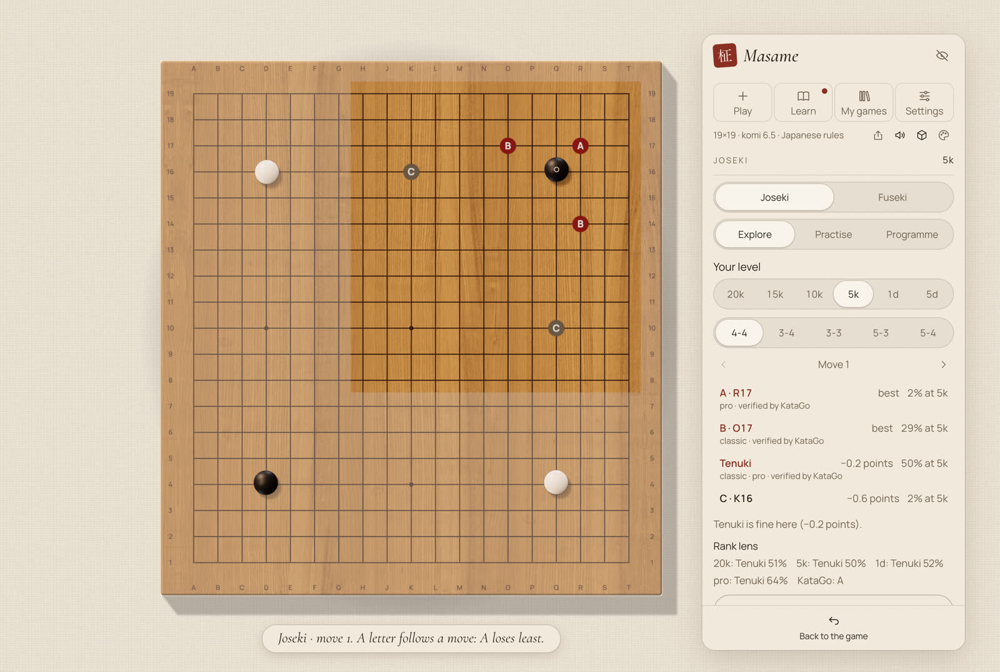
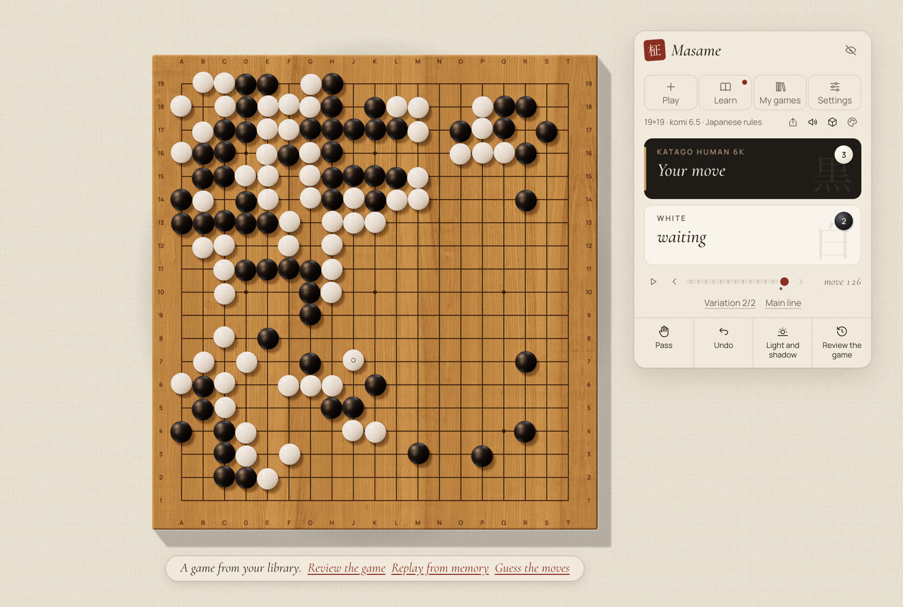
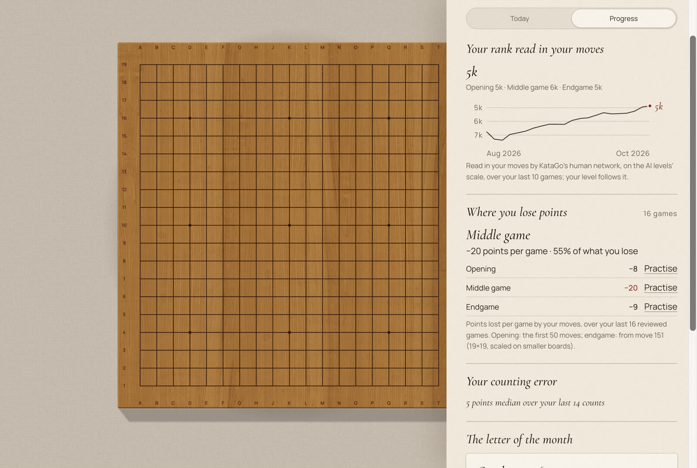

<p align="center">
  
</p>

<h1 align="center">Masame <sub>柾目</sub></h1>

<p align="center">
  <i>A craftsman's Go board — and a teacher that plays like a human.</i>
</p>

<p align="center">
  <a href="LICENSE"></a>
  
  
</p>

<p align="center"><sub>English · <a href="README.fr.md">Français</a></sub></p>

<br>

*Masame* is the straight, parallel grain that marks the finest kaya Go boards. This app is built in the same spirit: a goban with real proportions and real materials, wood and slate and shell rendered in a light that follows the hour of the day. Across it sits KataGo, playing not like a machine but like a human of the rank you choose, from 20 kyu to 9 dan. It speaks French and English, works offline, keeps your games to yourself, and is free.

<br>

<table>
  <tr>
    <td width="50%"><br><sub><b>Study.</b> The board seen from above, the game on a floating card with its four doors.</sub></td>
    <td width="50%"><br><sub><b>Contemplation.</b> The board as it sits on the table, seen from where you sit, in the evening.</sub></td>
  </tr>
  <tr>
    <td width="50%"><br><sub><b>Learn.</b> Today's ritual, then each deck with what is due.</sub></td>
    <td width="50%"><br><sub><b>My games.</b> Every game kept on your machine, the ongoing OGS games first.</sub></td>
  </tr>
  <tr>
    <td width="50%"><br><sub><b>Tsumego.</b> A life-and-death problem from one of your games, on the whole board.</sub></td>
    <td width="50%"><br><sub><b>Counting.</b> Who leads, and by how much? Then KataGo's count, and the light on the board.</sub></td>
  </tr>
  <tr>
    <td width="50%"><br><sub><b>The Classics.</b> The ear-reddening game, 1846: play each move before you see Shusaku's.</sub></td>
    <td width="50%"><br><sub><b>Kifu.</b> The record as a book prints it, for the printer or a PDF.</sub></td>
  </tr>
  <tr>
    <td width="50%"><br><sub><b>Review.</b> Each costly move becomes a short lesson, here at the punishment.</sub></td>
    <td width="50%"><br><sub><b>Online.</b> A live game on OGS, with byo-yomi clocks on both cards.</sub></td>
  </tr>
  <tr>
    <td width="50%"><br><sub><b>Joseki.</b> Candidate moves lettered on the board, with the points each loses and how often players of your level choose it.</sub></td>
    <td width="50%"><br><sub><b>Variations.</b> Play from an earlier move and the game keeps both lines; ↑ ↓ switch between them.</sub></td>
  </tr>
  <tr>
    <td width="50%"><br><sub><b>Light and Shadow.</b> Territory shown as light and shade falling on the wood.</sub></td>
    <td width="50%"><br><sub><b>End of the game.</b> Dead stones suggested by the engine, corrected with a click.</sub></td>
  </tr>
  <tr>
    <td width="50%"><br><sub><b>Progress.</b> Your rank read in your moves, where you lose your points, and your counting error.</sub></td>
    <td width="50%"><br><sub><b>Light mode.</b> A quiet 2D board, and the fallback when 3D is unavailable.</sub></td>
  </tr>
  <tr>
    <td width="50%"><br><sub><b>Networks.</b> Official KataGo networks, downloaded and verified in the app.</sub></td>
    <td width="50%"></td>
  </tr>
</table>

## Features

The board takes the window; beside it, one floating card holds the game. Its header has four doors: **Play**, **Learn**, **My games** and **Settings**. Each opens on what is going on now, then shows the rest. Every action has one place, and the keyboard and the macOS menu bar follow it.

### Play

- **The Living Atelier.** A real-time three.js board with physically based wood and stones, light that follows the time of day, two views (Study, and a seated Contemplation view you can turn and zoom with the mouse), and bowls with lids for the spare and captured stones. 9×9, 13×13 and 19×19.
- **A human opponent.** KataGo with its human SL network imitates a player from 20k to 9d, with optional automatic level adjustment and natural thinking times. Handicap games from 2 to 9 stones, proposed from the gap between your level and the AI's.
- **Masters of an era.** Play the professionals of 1850, 1900, 1935, 1970, 2005 or 2023, as KataGo's human network plays them, with the handicap of the old teaching games, up to nine stones.
- **The Mentor.** Switch it on, and Masame stops you when a move costs too much (4 points at 19×19, 3 at 13×13, 2 at 9×9): try again, or keep it. A game with the mentor is a lesson, so it never counts toward your rank.
- **The game in progress survives a restart.** Close Masame in the middle of a game and it reopens on the same position, the clock paused, without asking.
- **From a position.** Set up a position stone by stone, from a book or a game, then play it against the AI or between two players, or save it.
- **Light and Shadow.** KataGo's ownership estimate shown as real light and shade on the board.
- **Counting.** The engine proposes the dead stones; you correct them with a click.
- **Free analysis.** Hold A on any position, outside an ongoing OGS game: KataGo's candidate moves appear lettered on the board, with the points each one loses. No win-rate graph.
- **Online play on OGS.** Ranked games and challenges on [online-go.com](https://online-go.com), with clocks, correspondence included; watch the best live games. Your ongoing and finished OGS games are in My games, and your finished games are reviewed automatically.
- **Rules and records.** Captures, ko, suicide, pass, undo, move navigation, variations, autoplay, a byo-yomi clock for local games, and SGF open and save that keep variations and comments.

### Learn

- **Today.** A daily ritual of about ten minutes: a hand of six exercises (from your games, tsumego and counting, leaning toward your weakest phase), five joseki or fuseki cards, then a 9×9 against the AI at your level, with a streak of days. Below it, each deck with what is due.
- **Exercises from your games.** Each review's key moments come back as exercises with spaced repetition: find a better move, and KataGo grades it.
- **Tsumego from your games.** Masame finds life-and-death problems in your reviewed games and shows them on the whole board, the problem's area framed: save the group or kill it; when you miss, KataGo plays the refutation.
- **Counting.** Who leads, and by how much? A position from one of your reviewed games, your guess, then KataGo's count and the light on the board.
- **Joseki trainer.** Explore the candidate moves with the points each one loses, how often players of your level play it, and where it comes from (classic, pro, AI, verified by KataGo, contested). Practise with spaced repetition, in random orientations and colours, against an opponent who leaves the book like players of your level. A programme orders the corners by how often you'll meet them × the points they cost you. The joseki are generated by us with KataGo and its human SL network.
- **Fuseki.** The twelve first moves of the whole board, generated like the joseki, to explore and to practise.
- **The Classics.** Twenty-one games of the Edo period to guess move by move: you play each move before you see the master's, and KataGo tells what yours costs. Their sources are named in [SOURCES.md](public/assets/classics/SOURCES.md).
- **Progress.** Your rank read in your moves, your OGS rank, where you lose your points, and your counting error, on one page.
- **Your rank, read in your moves.** KataGo's human network tells which rank your moves resemble, game by game and phase by phase ("you played like a 7k: opening 4k, endgame 12k"), on the scale of the AI levels. That scale reads kyu players stronger than OGS does: about two ranks for single-digit kyu, about five for double-digit kyu. With automatic adjustment it sets your level and keeps the AI within two ranks of it; your local rank is drawn over time.
- **Practise a phase.** Next to where you lose your points, one button per phase: the fuseki for the opening, exercises and tsumego for the middle game, and for the endgame a yose session that asks for the biggest move.
- **The monthly letter.** Each month, a short letter of what you played and learned, in a sentence per fact, which you can save as an image.

### My games

- **The library.** Every game you play against the AI or between two players, your OGS games, the positions you save and the files you review are kept on your machine, with their result, the rank read in your moves, their key moments and your scores. Filter by source, search by opponent, open one with a click. Your ongoing OGS games come first, the ones where it's your move on top.
- **Game review.** Up to three moments where a move cost the most points, each a short lesson: find the punishment yourself, see it, then see the better move. After a game against the AI, or at any time in a two-player or SGF game. It runs locally, in about a minute. From a key moment you can also try your own continuation, and KataGo answers. Every finished game is also read in the background, on your machine, as soon as the engine is free, and its key moments join your exercises without a click.
- **Replay from memory.** The board empties and you replay the game, both sides, move by move; after a second miss the move is shown. Your score joins the game in My games.
- **Guess the moves.** The Classics' mode, on any game of your library.
- **Share.** One small sheet: save the game as SGF, make a postcard, print a kifu, or copy the OGS link.
- **Kifu.** The record as books print it, a numbered diagram per hundred moves, to print or save as PDF through the system dialog, or as a PNG.
- **Postcard.** The position as a PNG, a print of the 3D board signed with Masame's seal, ready for Reddit or Discord.
- **Import.** Open an SGF from My games, drop it on the window, or double-click it.

### Settings

- **Seasons in the light.** In Auto, the light follows the hour and the date: a longer golden hour in summer, low cold light in winter, and the glare of snow in the Washitsu from December to February.
- **Two languages.** Entirely in French and English, following the system language, switchable in the app.
- **A 2D light mode.** A Canvas board, used automatically when the 3D renderer is unavailable.

## Status

Masame is young, and honest about it.

- **macOS, Apple Silicon** works today. The engine is a self-contained KataGo 1.18.2 (Metal) with static dependencies; it needs macOS 13 or later and no Homebrew libraries at run time.
- **macOS, Intel**: the same app with KataGo 1.18.2 built for OpenCL, with automatic CPU fallback; macOS 13 or later. A preview.
- **Windows** support is written — the code, the NSIS installer and a KataGo OpenCL build with automatic CPU fallback — and built by GitHub Actions. The installer is available as a preview, not yet tested on real hardware.
- **Linux, x86_64**: an AppImage, a .deb and an .rpm, built on Ubuntu 22.04 by GitHub Actions, with KataGo 1.18.2 compiled from source (OpenCL, with automatic CPU fallback). Also a preview.

**Download** the latest version from the [releases page](https://github.com/Slymaster/masame/releases/latest): a DMG for macOS (Apple Silicon, or Intel: the `x64` DMG), an installer for Windows (x64), and an AppImage, a .deb and an .rpm for Linux (x86_64). The macOS build is signed and notarized by Apple, so it opens without a warning. The Windows build is not signed yet: when SmartScreen appears, click **More info**, then **Run anyway**.

On **Linux**, Masame needs glibc 2.35 or later (Ubuntu 22.04+, Debian 12, Fedora, Linux Mint 21+). A few things to know:

- The AppImage may need `libfuse2` (or run it with `--appimage-extract-and-run`).
- A blank window with NVIDIA's proprietary driver: start Masame with `WEBKIT_DISABLE_DMABUF_RENDERER=1`.
- Stone sounds need GStreamer's "good" plugins (`gstreamer1.0-plugins-good` on Debian and Ubuntu).
- The 3D board needs WebGL2; without it Masame uses the 2D board.

## Build from source

You will need Node.js 22, [pnpm](https://pnpm.io/) 9, [Rust](https://www.rust-lang.org/tools/install) (stable) with the [Tauri 2 prerequisites](https://v2.tauri.app/start/prerequisites/), and on macOS Xcode (for AppleClang, Swift and Metal) plus `cmake`, `ninja`, `pkg-config`, `curl` and `git`. Protobuf and abseil are built from pinned sources; see the header of [`scripts/build-katago.sh`](scripts/build-katago.sh).

On Linux (x86_64), build the engine with `scripts/build-katago-linux.sh` instead, which needs `g++`, `cmake`, `ninja`, `git` and the development packages for zlib, Eigen 3 and OpenCL (on Debian and Ubuntu: `ninja-build cmake zlib1g-dev libeigen3-dev ocl-icd-opencl-dev opencl-headers`). It builds the OpenCL and CPU engines into `src-tauri/resources/katago-linux/`.

For Intel Macs, `scripts/build-katago-macos-x86_64.sh` builds the OpenCL and CPU engines (on an Intel Mac, or cross-compiled on Apple Silicon) into `src-tauri/binaries/`; then build with `pnpm tauri build --target x86_64-apple-darwin --config src-tauri/tauri.macos-x86_64.conf.json`.

```sh
git clone https://github.com/Slymaster/masame.git
cd masame
pnpm install
scripts/build-katago.sh   # builds KataGo v1.18.2 (Metal) into src-tauri/binaries/
pnpm tauri dev
```

Tests: `pnpm test` (TypeScript) and `cargo test --manifest-path src-tauri/Cargo.toml` (Rust). Windows builds come from the GitHub Actions workflow ([`.github/workflows/build.yml`](.github/workflows/build.yml)); local instructions will follow once they are verified on hardware.

## Networks

Masame ships no neural network. On first use, the network manager reads the catalogue from the katagotraining.org API and downloads the networks you choose from `media.katagotraining.org`, the official KataGo distribution site. Each file is checked against its published sha256 (or, for the human SL network, a sha256 pinned in the app) before it is used, and a corrupted download is deleted. Networks are stored locally, in the app's data folder: `~/Library/Application Support/com.sylvainrey.masame/models/` on macOS.

The networks are published by the KataGo project under the [KataGo Neural Network License](https://katagotraining.org/network_license/).

## OGS

Masame is an OGS client. Choose OGS as the opponent in Play and sign in: sign-in happens in your browser, and Masame never sees your password. Then:

- **Find an opponent** (automatch) at 9×9, 13×13 or 19×19, in blitz, rapid, live or correspondence pace. A correspondence search keeps running in the background.
- **Challenge a player** by OGS username (ranked or not, automatic handicap or even); accept or decline the challenges you receive; offer a rematch after a game.
- **During a game:** cancel it in the first moves, ask your opponent to take back a move (or accept their request), pause and resume. Free handicap placement is supported. When OGS can't propose the dead stones itself, Masame asks OGS's own scorer.
- **My games:** your ongoing games open the My games door, the ones where it's your move on top; your finished games page by page, kept in your library as soon as you open one. Your OGS rank over time is in Learn › Progress.
- **Watch:** the best live games, or any game from an OGS link, even without signing in. Engine help stays off until the game ends.
- **Notifications:** while Masame is open in the background, a system notification tells you when it's your move in a correspondence game, when a challenge arrives, and when a game starts or ends.

OGS doesn't allow engine help during a game, so while an OGS game is going on, Light and Shadow, the free analysis, the engine's counting suggestions, the review, the mentor and the trainers that use the engine are off. They come back as soon as the game is over, and your finished OGS games are then reviewed automatically.

## Privacy

- No telemetry, no analytics, no Masame account.
- Network requests go to katagotraining.org (the network catalogue and the network downloads) and to GitHub for updates (github.com and its file servers). If you sign in to OGS, Masame connects to online-go.com as soon as it starts, so you appear online there while it's open. To propose dead stones when OGS's own proposal fails, it may send the final position to ai.online-go.com (OGS's scorer). Watching games without an account uses an anonymous OGS connection.
- At most once a day, Masame asks GitHub whether a new version exists (you can turn this off in Settings). An update is downloaded only when you click Install, and is checked against Masame's signing key before it is installed.
- Your games stay on your machine. The library is a folder in the app's data folder (`games/`, next to `models/`), and nothing in it is sent anywhere. SGF files you export are saved where you choose.

## Roadmap

The foundations, the 3D Living Atelier and the teacher are in place, with the OGS client. Version 0.3 added the joseki trainer, variations and autoplay; version 0.4 read your games: the automatic review, exercises from your games, your rank read in your moves, the daily ritual, handicap, free analysis, a local clock and the postcard. Version 0.5 makes your lessons from your games: the library, tsumego, counting, replay from memory and the Classics, with the Masters of an era, the mentor, the position editor and the kifu. Next comes Masame on Android, as a beta, and a signed Windows installer. The full plan and its reasoning are in [docs/proposal.en.md](docs/proposal.en.md) (in French: [docs/proposition.md](docs/proposition.md)).

## Credits

- [KataGo](https://github.com/lightvector/KataGo) by David J Wu ("lightvector") and contributors: the engine and its neural networks.
- [@sabaki/go-board](https://github.com/SabakiHQ/go-board) and [@sabaki/sgf](https://github.com/SabakiHQ/sgf) by Yichuan Shen: board logic and SGF parsing.
- [goban](https://github.com/online-go/goban) by Online-Go.com: the OGS client's connection and protocol (`goban-engine`, Apache-2.0).
- [FSRS](https://github.com/open-spaced-repetition) by Open Spaced Repetition: the spaced repetition behind joseki practice (MIT).
- [three.js](https://threejs.org/), [Tauri](https://tauri.app/) and [React](https://react.dev/).
- Wood textures from [ambientCG](https://ambientcg.com/), lighting (HDRI) from [Poly Haven](https://polyhaven.com/), stone sounds from [Freesound](https://freesound.org/) by billhails2, Hongsungbock and MPooman — all CC0.
- Typefaces: Cormorant Garamond and Manrope, under the SIL Open Font License.

## Licence

Masame is released under the [MIT licence](LICENSE). Third-party components keep their own licences; the full list is in [THIRD_PARTY_NOTICES.md](THIRD_PARTY_NOTICES.md).
